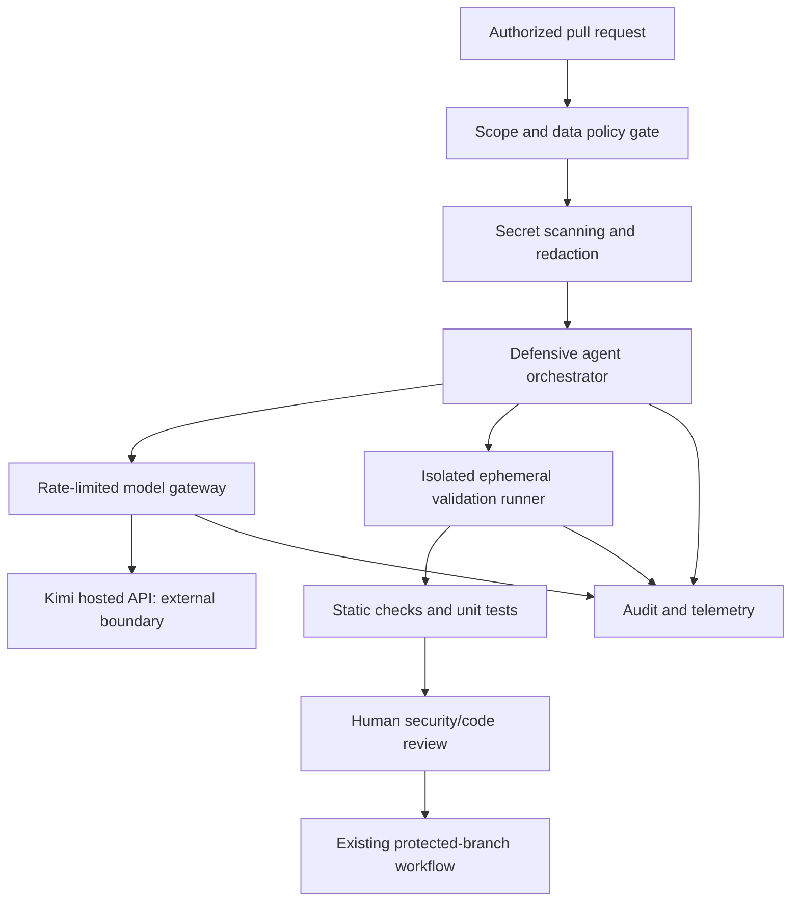

# Architecture and Design Decisions — Kimi K3.1 Pro Defensive Review Pilot

- **Record ID:** ADR-2026-10-25-KIMI-CYBER
- **Status:** Proposed / editorial reference architecture
- **Date:** 25 October 2026
- **Scope:** Safe, permissioned DevSecOps pilot using a hosted AI model
- **Evidence level:** Conceptual design; not deployed or load-tested

## Context

Kimi K3.1 Pro is accessible by API as of 25 October 2026. Its full open weights are promised by 4 November, not yet verified as published. The model's vendor-reported offensive evaluation and an independently administered defensive evaluation address different capabilities. Neither result establishes production safety.

## System context

See [the standalone SVG](../diagrams/2026-10-25-kimi-k31-pro-cyber-paradox-context.svg) and [the companion article](../articles/2026/10/2026-10-25-kimi-k31-pro-cyber-paradox.md).

## Decisions

### ADR-01 — Start with API-based evaluation, not self-hosting
- **Decision:** Pilot the hosted API using authorized, redacted test data.
- **Why:** Weights are not yet public, so local-serving claims cannot be validated.
- **Alternatives:** Wait for open weights; use an existing local model.
- **Trade-offs:** Faster evaluation and less GPU management versus external data processing, network dependency and usage charges.
- **Revisit when:** Weights, license, inference compatibility and hardware requirements are published.

### ADR-02 — Enforce authorization outside the model
- **Decision:** Policy gateway validates repository allowlists, data classes, tool permissions and budgets.
- **Why:** Prompt injection in repository content can redirect an agent. The LLM is not a security boundary.
- **Alternatives:** Rely on system prompts or model refusal.
- **Trade-offs:** Extra integration work, but explicit and auditable enforcement.
- **Control:** Deny by default; separate identity for the gateway and runner.

### ADR-03 — Run validation in isolated, short-lived environments
- **Decision:** Ephemeral sandbox with no production credentials, restricted egress and least-privilege filesystem access.
- **Why:** AI-suggested code and test fixtures are untrusted.
- **Alternatives:** Shared CI runner; developer workstation; dedicated microVM.
- **Trade-offs:** Container sandboxes are cheaper but share a kernel; stronger VM isolation increases cost and startup latency. Select isolation based on threat model.

### ADR-04 — Human-approved patch-only output
- **Decision:** The agent may propose changes in a disposable branch; protected-branch merges and deployments require existing CI and a human reviewer.
- **Why:** Model quality rankings do not prove patch correctness or absence of regressions.
- **Alternatives:** Automatic merge or autonomous deployment.
- **Trade-offs:** Lower throughput but safer rollout and better accountability.

### ADR-05 — Independent evidence and observability
- **Decision:** Record prompts (with sensitive fields removed), model ID, code revision, tool results, reviewer outcome, cost and latency.
- **Why:** Reproducibility and incident response require more than a final model answer.
- **Alternatives:** Store raw prompts or no telemetry.
- **Trade-offs:** Redacted audit logs reduce privacy exposure but may limit forensic detail; establish retention policy and access controls.

### ADR-06 — Model-agnostic gateway
- **Decision:** Hide provider-specific API details behind a narrow internal interface.
- **Why:** Supports A/B tests against baseline models and a future move to sovereign inference.
- **Alternatives:** Direct model API calls in every agent component.
- **Trade-offs:** More engineering initially, less vendor lock-in later.

## Non-goals

- No exploit-development workflow or unauthorized vulnerability scanning.
- No claim that a filtered model is incapable of misuse.
- No claim of local K3.1 Pro deployment before model weights and compatible runtime are available.
- No production-grade certification or measured throughput figures.

## Pilot acceptance criteria

1. Approved test repositories only, with recorded authorization.
2. No secrets in outbound model requests or audit records.
3. All suggested changes reviewed and verified by standard tests.
4. No autonomous production writes or protected-branch merges.
5. Measured quality, false positives, cost and latency on a repeatable defensive task suite.
6. Documented kill switch, rollback and incident escalation.

## Sources

- Moonshot launch and cyber methodology: https://www.kimi.ai/blog/kimi-k3-1-pro
- Independent defensive index: https://artificialanalysis.ai/evaluations/artificial-analysis-cyber-index
- Model availability and characteristics: https://artificialanalysis.ai/models/kimi-k3-1-pro
