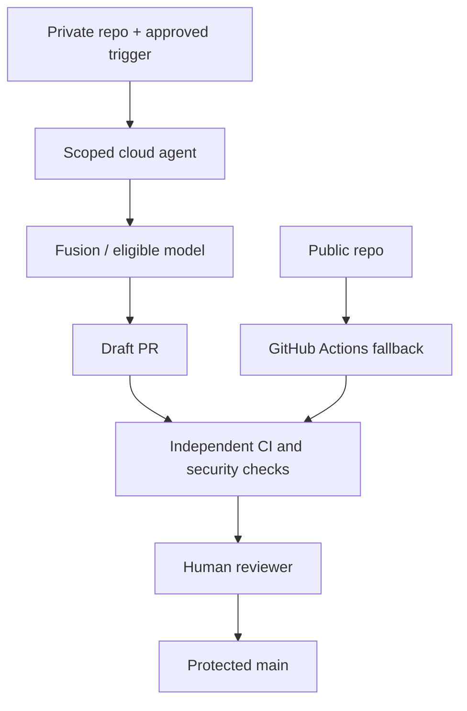

# Architecture decisions — GitHub Copilot Fusion and automations

**Date:** 2026-10-29 | **Status:** Proposed; not a deployment report.  
**Article:** [GitHub Universe 2026 analysis](../articles/2026/10/2026-10-29-github-copilot-automations.md)  
**Diagram:** [Agentic delivery SVG](../diagrams/2026-10-29-github-copilot-automations-context.svg)

## Scope and evidence

GitHub introduced Copilot Fusion and new automation capabilities on 28 October 2026. GitHub's docs explicitly limit **Copilot automations to private/internal repositories** and describe optional routing to specific local models in **Fusion Standard** public preview. We propose controls for a hypothetical engineering organization; this is not an implementation of GitHub's internals.

## ADR-001 — Use a private test repository for Copilot automations
- **Decision:** Pilot the automation feature in a private sandbox repository with synthetic issues and tests.
- **Alternatives:** Public repo; skip pilot; ordinary GitHub Actions.
- **Reason:** GitHub Docs explicitly exclude public repositories.
- **Trade-off:** Private demo is less immediately reproducible for a public audience; publish a separate Actions fallback.

## ADR-002 — Minimal tool scopes and separate MCP review
- **Decision:** Give agent only repository read and proposed PR write capabilities needed for the task; inspect every MCP server's external access.
- **Alternatives:** Broad administrative token; default tools without review.
- **Reason:** Untrusted repository content can attempt prompt injection; MCP credentials may cross repo boundaries.
- **Trade-off:** Narrow permissions may block some useful automation actions.

## ADR-003 — No autonomous merge or deploy
- **Decision:** Agent changes go to branches, CI runs independently, protected branches require human approval.
- **Alternatives:** Merge-on-green; direct pushes.
- **Reason:** Agent quality and code-review benchmarks do not eliminate supply-chain and regression risks.
- **Trade-off:** More review latency; fewer unsafe changes.

## ADR-004 — Explicit budget limits and audit trail
- **Decision:** Set per-run AI credit limit, track Actions minutes and per-task cost, retain prompts, model versions, reviewer decisions, and logs according to retention policy.
- **Alternatives:** Unlimited credits; untracked sessions.
- **Reason:** Multi-model routing and repeated automations can create unpredictable bills.
- **Trade-off:** Budgets can interrupt useful tasks; audit retention raises privacy obligations.

## ADR-005 — Local-model routing is opt-in and tested
- **Decision:** Test documented Fusion Standard local-model paths only with synthetic code; inspect routing and network activity before sending proprietary data.
- **Alternatives:** Assume all Fusion calls are local; force cloud-only; use a separate local coding assistant.
- **Reason:** GitHub supports only specified local models in public preview, not arbitrary Ollama installations.
- **Trade-off:** More setup, local hardware constraints, possible mixed cloud/local execution.

## ADR-006 — Version-control automation intent separately
- **Decision:** Maintain human-reviewed task specifications and policies in repo documentation even though Copilot automations themselves are stored outside Git; consider GitHub Agentic Workflows when versioned execution definitions are required.
- **Alternatives:** Treat UI automation as source-controlled; use ad hoc personal prompts.
- **Reason:** Auditability, change review and portability.
- **Trade-off:** Some duplication between documented intent and configured automation.

## Reference workflow

## Acceptance checklist

- [ ] Private/internal repository and cloud agent enablement verified
- [ ] Tool scopes, MCP permissions and external egress reviewed
- [ ] Trigger source and untrusted-input handling documented
- [ ] Per-run credit and Actions-minute budgets established
- [ ] CI and human approval required for every change
- [ ] Public repository fallback clearly distinguished
- [ ] Local-model data residency claims verified with observed routing

## Sources

- GitHub Universe (28 Oct 2026): https://github.blog/news-insights/company-news/github-universe-2026-evolving-every-layer-of-the-stack/
- GitHub automations docs: https://docs.github.com/en/copilot/concepts/agent-capabilities/agent-powered-workflows-and-operations/about-automations
- GitHub Fusion docs: https://docs.github.com/en/copilot/concepts/models/copilot-fusion
