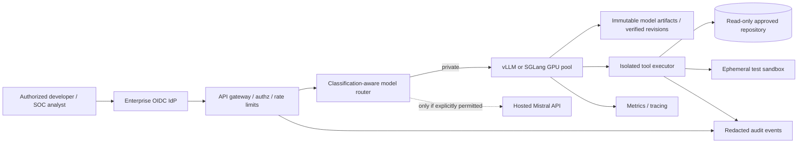

# Architecture and Design Decisions — Mistral Large 4 Sovereign Inference

**Date:** 30 October 2026  
**Status:** Proposed reference architecture — **not deployed, load-tested, or security-certified**.  
**Companion article:** [Mistral Large 4 self-hosting analysis](../articles/2026/10/2026-10-30-mistral-large-4-open-weights-self-hosting.md)  
**Diagram:** [Context SVG](../diagrams/2026-10-30-mistral-large-4-sovereign-inference-context.svg)

## Scope, assumptions and evidence

The 29 October 2026 release makes FP8 and NVFP4 model artifacts available, alongside GGUF conversions. This design describes an **enterprise-controlled inference service for approved code review, defensive security triage and technical assistance**. The user organization controls the identity plane, data classification, model routing, audit, and tool execution. Production data may not leave the organization's approved boundary without a specific authorization.

The model has approximately 1T total parameters and 49B active decoder parameters per token (approximately 52B including embedding/output layers). Its nominal 1M-token context is not assumed to be affordable at any particular batch size. Official NVFP4 serving is Blackwell-oriented; production capacity and GPU count must be determined by proof-of-concept. The cost of GPU hosting, model quality and end-to-end security have **not** been measured here.

## C4-style context and trust boundaries

**Boundaries:** Identity/tenant; public client/private gateway; policy router/private model pool; inference worker/isolated tools; internal/optional external API. Every boundary must be independently enforced; prompts are not access-control mechanisms.

## Decision record

### ADR-001 — Keep an API-first evaluation phase before procuring GPUs
- **Decision:** Compare the hosted API with a representative workload and a predeclared data-classification policy. Use synthetic or approved non-sensitive prompts initially.
- **Rationale:** Avoid buying accelerators before establishing quality, token demand, latency and business value.
- **Alternatives:** Buy a full private cluster immediately; run only smaller models.
- **Trade-offs:** Hosted testing is fast and cheap to begin, but may not meet strict residency rules. If hosted testing is prohibited, use a smaller private baseline and postpone Large 4 evaluation until suitable hardware is available.
- **Exit criterion:** Document cost per *successful* task, policy constraints and accuracy before approving private pilot.

### ADR-002 — Separate checkpoint size from active compute in capacity plans
- **Decision:** Plan for approximately 1T total weights and quantify real model footprint per checkpoint; do not size as a 52B model.
- **Rationale:** MoE routing reduces active compute but not the total stored expert collection. KV cache, quantization scales, runtime and concurrency require additional memory.
- **Alternatives:** Assume active parameter count is the memory size; offload most experts to CPU or disk.
- **Trade-offs:** Offload may permit a smaller GPU budget at substantial latency/bandwidth cost. FP8 favors quality and broad compatibility but has a large memory footprint; NVFP4 saves memory but is hardware-specific; GGUF offers portability with quality and throughput trade-offs.
- **Validation:** Pin checkpoint hash and measure peak VRAM, RAM, disk and latency under representative concurrency and context.

### ADR-003 — Use a private serving plane and an authenticated gateway
- **Decision:** Deploy vLLM/SGLang behind private networking and an OIDC-integrated gateway. Deny anonymous access and apply quotas per identity/tenant.
- **Rationale:** Model servers are compute-intensive and may expose confidential prompts or agent capabilities.
- **Alternatives:** Directly expose port 8000; place all authentication in the client.
- **Trade-offs:** A gateway adds latency and operational overhead but enables identity, usage control and incident response.
- **Validation:** Unauthorized requests fail closed; model workers cannot be reached from untrusted networks.

### ADR-004 — Keep tools out of the inference worker
- **Decision:** Execute code, tests and retrieval through an independent isolated service using short-lived credentials and read-only source access by default.
- **Rationale:** An LLM may generate unsafe tool requests; model guardrails cannot substitute for OS/network isolation.
- **Alternatives:** Allow model-serving containers to mount repositories and execute commands directly.
- **Trade-offs:** Extra orchestration and latency versus substantially smaller blast radius.
- **Validation:** Network deny-by-default; no production write tokens in worker; ephemeral sandboxes; per-tool allowlists; human approval for consequential operations.

### ADR-005 — Make data-classification-aware hosted fallback opt-in
- **Decision:** Route restricted data to the approved private serving pool only. Hosted fallback requires a classification and compliance decision, not an automatic timeout response.
- **Rationale:** A hidden fallback can violate data residency or contractual terms.
- **Alternatives:** Always fallback to the lowest-latency public endpoint.
- **Trade-offs:** Private-only routes may become unavailable during outages; this is preferable to silently breaching residency constraints.
- **Validation:** Synthetic restricted prompt during private outage is blocked, not forwarded externally.

### ADR-006 — Pin model revisions and preserve provenance
- **Decision:** Store model artifacts in an access-controlled registry with verified revision, manifest, hashes, license and SBOM/scan metadata where supported.
- **Rationale:** Mutable model references complicate reproducibility and supply-chain investigations.
- **Alternatives:** Pull latest weights directly from a public repository on every deployment.
- **Trade-offs:** Storage cost and release engineering work versus auditability and rollback.
- **Validation:** Rebuild can retrieve the same artifact; promotion requires review and signature/hash verification.

### ADR-007 — Human review for defensive security output
- **Decision:** Let the model propose findings and patches only; require independent reproduction, automated regression tests and human-reviewed pull requests before merge.
- **Rationale:** Vendor cyber scores and refusal rates do not prove correctness or operational safety.
- **Alternatives:** Autonomous changes to live production services.
- **Trade-offs:** Slower remediation but lower false-positive and regression risk.
- **Validation:** Known-good/known-bad test repositories, false-positive analysis, rollback and full audit trail.

### ADR-008 — Evaluate TCO, energy, throughput and reliability together
- **Decision:** Choose API, private cloud or hybrid based on cost per successful task, residency, peak load, utilization, reliability, and operational staffing.
- **Rationale:** GPU-hour price alone excludes idle reservation, networking, SRE, power, model updates and security.
- **Alternatives:** Choose by model leaderboard or theoretical tokens/sec alone.
- **Trade-offs:** Private infrastructure may improve control but raises capital and staffing costs. Hosted API reduces upfront commitment but creates provider dependency.
- **Validation:** Benchmark p50/p95 latency, throughput, concurrency, peak memory, total operating cost, patch accuracy, and failover policy.

## Threat model and safeguards

| Threat | Boundary | Proposed safeguard | Verification |
|---|---|---|---|
| Unauthenticated inference access | Client → gateway | OIDC, authz, rate limits | 401/403 and throttling tests |
| Prompt or source-code disclosure | Gateway → logs / hosted fallback | Redacted logging; classification route | Synthetic canary audit |
| Prompt injection leading to tool misuse | Model → tool executor | Independent allowlists, scoped tokens, isolation | Benign injection test suite |
| Malicious / replaced model artifact | Registry → serving | Revision pin, hash and approval | Tamper-detection test |
| GPU denial-of-service | Tenant → inference pool | Context/concurrency quotas | Controlled load test |
| Unauthorized code modification | Tool → repository | Read-only token, PR-only patch workflow | Permission-denial test |
| Production network escape | Sandbox → external services | Default-deny egress and segmentation | Egress-policy verification |

## Deployment sequence

1. **Governance:** approve use case, license, model residency, data classes and risk owner.
2. **Baseline:** test hosted model on synthetic workloads where allowed; compare smaller private baseline.
3. **Capacity:** measure candidate FP8/NVFP4/GGUF footprint and estimate GPU memory with headroom.
4. **Pilot:** isolated private GPU pool, pinned weights, identity-aware gateway and egress controls.
5. **Validation:** deterministic test corpus, independent checks, prompt-injection resilience and SRE load tests.
6. **Production decision:** signed risk acceptance, explicit SLOs, rollback plan and recurring evaluation.

## Licensing decision gate

The [Mistral Ecosystem Open-Weight License](https://huggingface.co/mistralai/Mistral-Large-4-1T-A52B/blob/main/LICENSE) is a modified MIT-style license; Mistral says commercial Model-as-a-Service businesses require a separate commercial agreement. Internal enterprise use and resale are **not interchangeable**. Legal counsel must review actual usage before a commercial service launch.

## Source documents

- Mistral AI release: https://mistral.ai/it/news/mistral-large-4-oss/
- Mistral AI FP8 model card: https://huggingface.co/mistralai/Mistral-Large-4-1T-A52B
- Mistral AI NVFP4 checkpoint: https://huggingface.co/mistralai/Mistral-Large-4-1T-A52B-NVFP4
- Hugging Face day-zero inference support: https://huggingface.co/blog/mistral-large4
- License: https://huggingface.co/mistralai/Mistral-Large-4-1T-A52B/blob/main/LICENSE

**Design assurance:** No claim is made that this architecture has been built, benchmarked, audited, or certified.
