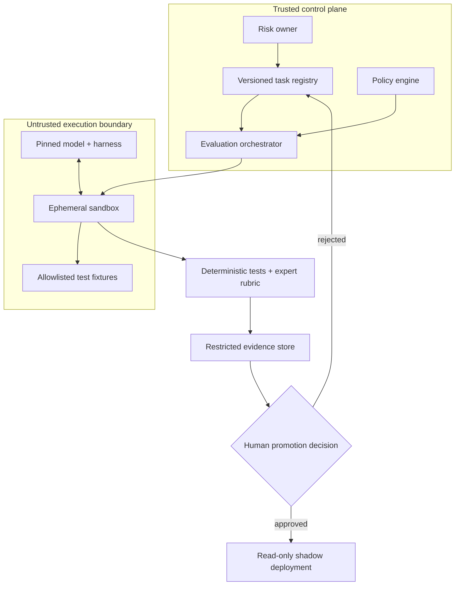

# Architecture Decision Record: GDPx-Inspired Enterprise Agent Evaluation

**ADR ID:** ADR-2026-11-03-GDPX-001  
**Status:** Proposed; not deployed or independently benchmarked  
**Date:** 2026-11-03  
**Companion article:** `articles/2026/11/2026-11-03-gdpx-agent-benchmark-enterprise-evaluation.md`

## Context

SemiAnalysis launched GDPx on November 2, 2026, with 206 tasks across 11 domains. Its results demonstrate that long-horizon, tool-using agent evaluations differ from single-turn model tests. We propose a **separate enterprise evaluation system**, not a recreation of GDPx's proprietary benchmark. References: https://newsletter.semianalysis.com/p/gdpx-measuring-frontier-model-capabilities and https://gdpx.semianalysis.com/.

## ADR-01 — Version all evaluation inputs

**Decision:** Store task fixtures, rubric revisions, model IDs, harness versions, tool policies and environment hashes in a versioned registry. **Why:** comparisons are otherwise confounded by changes in prompts or tools. **Alternative:** ad-hoc spreadsheets; faster to start but weak provenance. **Trade-off:** extra maintenance and data governance.

## ADR-02 — Run agents in ephemeral isolated sandboxes

**Decision:** Use disposable containers or VMs, restricted egress, no production secrets, resource limits and scoped workload identities. **Why:** agent tool calls are not trustworthy by default. **Alternative:** shared development machines; cheaper but materially riskier. **Trade-off:** environment setup cost and incomplete simulation of real-world services.

## ADR-03 — Treat model and harness as one testable configuration

**Decision:** Pin model, provider endpoint, orchestration version, system prompts, tool versions and timeout together. **Why:** GDPx uses native harnesses where available; rankings do not isolate pure model ability. **Alternative:** compare models with different untracked agents; easier but misleading. **Trade-off:** more combinations to test.

## ADR-04 — Combine deterministic grading with blinded expert review

**Decision:** Validate machine-checkable outputs using tests and schemas; use subject-matter experts for ambiguous deliverables. **Why:** purely exact-match grading penalizes valid alternatives, while subjective review can drift. **Alternative:** LLM-only grading; cheap but vulnerable to bias. **Trade-off:** human reviewer cost and inter-rater disagreement.

## ADR-05 — Gate writes and external actions

**Decision:** Default to read-only; sandbox writes require scoped authorization; production changes require explicit human approval and rollback plan. **Why:** benchmark success is not production authorization. **Alternative:** fully autonomous agent; lower latency but greater blast radius. **Trade-off:** less throughput, stronger control.

## ADR-06 — Optimize for accepted outcomes, not headline score

**Decision:** Track task-specific acceptance rate, cost per accepted result, review time, p95 latency, safety incidents and rollback outcomes. **Why:** aggregate rankings obscure domain fit and hidden costs. **Alternative:** choose highest GDPx composite; simple but not task-specific. **Trade-off:** ongoing measurement burden.

## ADR-07 — Preserve immutable evidence with privacy boundaries

**Decision:** Store sanitized execution traces, test outputs and approval decisions in restricted append-only storage with retention limits. **Why:** auditability and regression analysis. **Alternative:** full raw logs; convenient but may leak secrets and personal data. **Trade-off:** redaction can limit debugging detail.

## ADR-08 — Separate evaluation, shadow mode and production rollout

**Decision:** Require distinct promotion gates and risk-owner signoff; shadow mode cannot perform live writes. **Why:** synthetic benchmark performance does not prove real-world reliability. **Alternative:** direct launch from demo; faster but unjustified. **Trade-off:** slower deployment and higher evaluation cost.

## Proposed trust boundaries

**Threats:** prompt injection through retrieved documents; unsafe shell commands; credential leakage; data exfiltration; reward hacking; test contamination; false positive graders; uncontrolled external effects. **Mitigations:** least privilege, sandboxing, explicit egress rules, pre-registered graders, fixture provenance, independent review, approval gates and incident response.

## Validation required before deployment

Conduct a threat-model review; prove network isolation and secret denial; test prompt-injection and tool-failure scenarios; independently audit grading; measure repeatability and cost; exercise rollback and retention deletion; obtain legal/privacy review for any production-derived fixtures.

**No implementation or test results are claimed by this ADR.**
