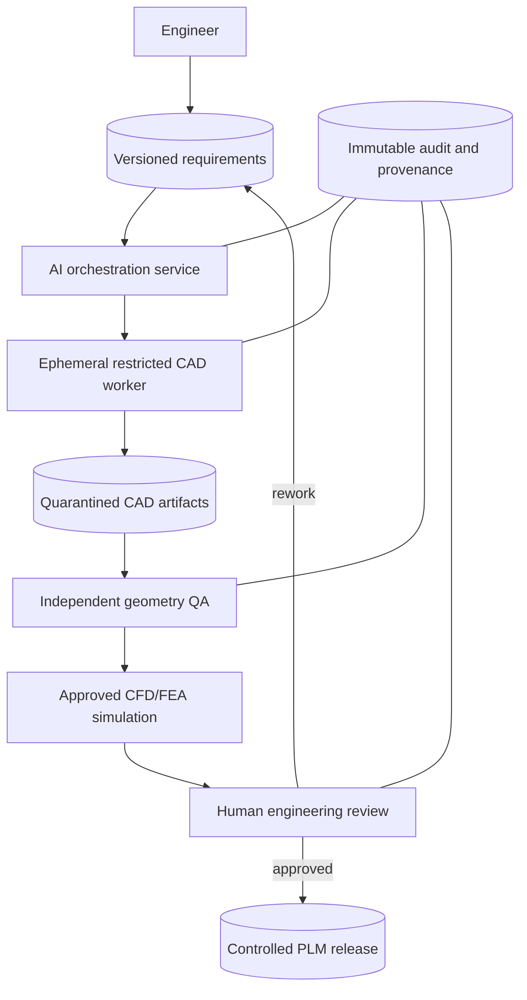

# Architecture and design decisions — AI-assisted automotive CAD workflow
**Date:** 2026-11-04  
**Status:** Proposed reference architecture; not deployed or validated by the author.

## Context
OpenAI's 3 November 2026 engineering report describes AI-assisted CAD, simulation, a prototype device, and collaborations with Mazda and Chip Ganassi Racing. It explicitly notes manufacturability limitations. The design below is an independent proposal for a **non-safety-critical educational pilot**, not an assertion about any vendor's actual systems.

## ADR-001 — Isolate generated CAD scripts
**Decision:** Execute scripts in an ephemeral sandbox with restricted file access, outbound network denied by default, CPU/memory limits, and no production credentials.  
**Rationale:** Generated code and imported design data may be untrusted.  
**Alternative:** Run scripts directly on engineers' workstations.  
**Trade-off:** Isolation adds setup and limits some interactive plugin capabilities but sharply reduces blast radius.

## ADR-002 — Keep requirements and CAD artifacts versioned
**Decision:** Store requirements, scripts, CAD revisions, tool versions, and artifact hashes with immutable build IDs.  
**Rationale:** Reproducibility and auditability require linking outputs to exact inputs.  
**Alternative:** Save only final CAD exports.  
**Trade-off:** More storage and metadata management; far better root-cause analysis.

## ADR-003 — Deterministic checks before simulations
**Decision:** Validate units, geometry integrity, envelope, holes, interference, and required constraints with independent tools before invoking CFD/FEA.  
**Rationale:** A language model's confidence is not an engineering test.  
**Alternative:** Ask a second model to review the design.  
**Trade-off:** Deterministic tests cover fewer semantic cases, but are repeatable; model review may supplement, never replace, checks.

## ADR-004 — Engineer-approved simulation configuration
**Decision:** Qualified engineers approve materials, loads, boundary conditions, solver settings, convergence criteria, and uncertainty before interpreting results.  
**Rationale:** Plausible numerical output may be physically invalid.  
**Alternative:** Let agents configure and approve their own simulations.  
**Trade-off:** Human review slows throughput but is essential for trustworthy decisions.

## ADR-005 — No autonomous product release
**Decision:** Only authorized humans may release drawings to suppliers or update controlled PLM baselines.  
**Rationale:** Manufacturability, safety, regulatory, and commercial accountability remain human obligations.  
**Alternative:** Fully autonomous drawing release.  
**Trade-off:** Lower automation ceiling; clear responsibility and safer change control.

## ADR-006 — Separate evidence, observability, and quality metrics
**Decision:** Capture tool calls, failed validations, reviewer changes, cycle time, compute spend, and rework. Compare against a controlled non-AI baseline.  
**Rationale:** Token volume and demos do not establish engineering productivity.  
**Alternative:** Track number of generated CAD files.  
**Trade-off:** Measurement overhead but prevents misleading ROI claims.

## ADR-007 — Restrict engineering data movement
**Decision:** Apply project-scoped identities, encryption, data classification, retention limits, and approved model endpoints.  
**Rationale:** CAD drawings, supplier data, and simulation results may be commercially sensitive.  
**Alternative:** Send complete projects to unrestricted hosted tools.  
**Trade-off:** May reduce model choice and increase integration effort; improves confidentiality.

## Proposed topology

## Non-goals
This proposal does not certify physical parts, reproduce BenchCAD 2.0, or assert access to OpenAI's internal hardware systems or its partners' environments.

## References
- OpenAI, 3 November 2026: https://openai.com/index/accelerating-engineering-for-the-physical-world/
- NIST AI RMF: https://www.nist.gov/itl/ai-risk-management-framework
- NIST SSDF: https://csrc.nist.gov/Projects/ssdf
