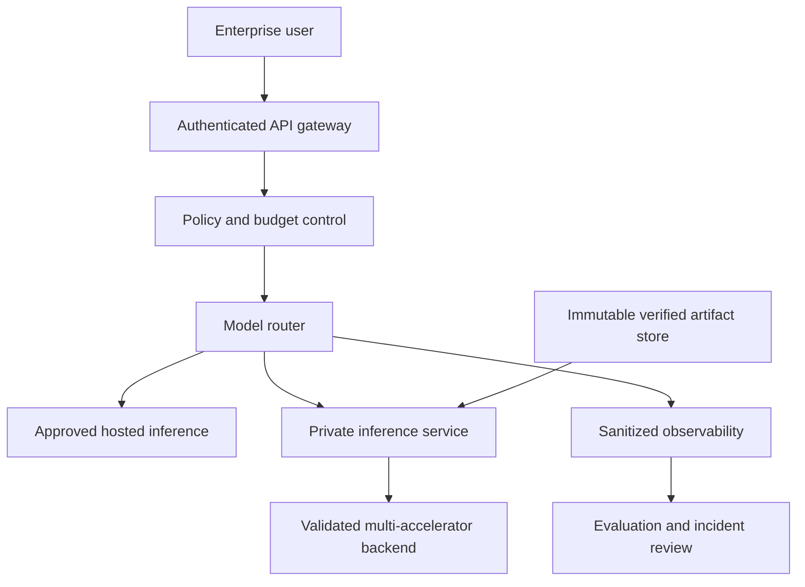
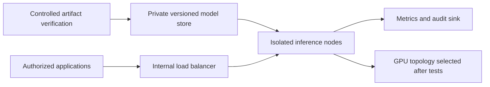

# Architecture Decision Record — Kimi K3.1 Pro Self-Hosting (5 November 2026)

**Status:** Proposed reference design; NOT deployed or performance-tested. Companion: `articles/2026/11/2026-11-05-kimi-k31-pro-weights-self-hosting.md`.

## Context
Moonshot's official repository lists 1.56 TB of artifacts, 2.8T total parameters and 104B active parameters, MXFP4/MXFP8 quantization and a custom commercial license. This design intentionally avoids claiming a tested hardware topology.

## Decisions
| ID | Decision | Rationale | Alternative | Trade-off / validation gate |
|---|---|---|---|---|
| 01 | Start with authorized API pilot | Characterize demand before GPU commitment | Buy cluster immediately | Vendor data terms vs avoided capex; verify DPA |
| 02 | Version-pin artifacts in controlled object store | Reproducibility, checksum checks | Pull latest on every boot | Storage duplication; validate digest manifest |
| 03 | Independent auth gateway | Quotas, identity, abuse detection | Expose engine directly | Small latency overhead; penetration-test gateway |
| 04 | Benchmark exact GPU topology | MoE weights must be resident or accessible despite sparse activation | Estimate from 104B active | Lab cost; test OOM, latency, KV cache and interconnect |
| 05 | Review custom model code and pin images | Supply-chain isolation | Unreviewed remote code and floating images | Maintenance effort; record signed approval |
| 06 | Route fallback to approved smaller model | Resilience and budget caps | Single giant-model dependency | Potential quality drop; compare acceptance tests |
| 07 | Legal review for external service | Model-as-a-Service and attribution conditions | Treat as Apache/MIT | Time to market; document revenue/MAU tests |
| 08 | Sandbox tool execution and keep human approval | LLM output is untrusted | Direct production command execution | Reduced autonomy; verify authorization and audit trails |

## Trust boundaries
1. User-to-gateway: authenticate, authorize, rate-limit and filter sensitive inputs.
2. Gateway-to-model: private service identities and encrypted transport.
3. Model-to-tools: no implicit shell/cloud credentials; approved tool proxy only.
4. Artifact registry-to-runtime: pinned revisions, reviewed custom code, integrity checks.
5. Telemetry: scrub secrets; separate audit storage from model service account.

## Proposed context diagram

## Proposed deployment diagram

## Acceptance criteria before production
Document model revision and license approval; verify exact engine/container/GPU compatibility; record measured p50/p95/p99 latency and OOM behavior; test quota exhaustion and fallback; confirm egress isolation, secret handling, and rollback. Do not market the diagrams as deployed infrastructure.

## References
- https://huggingface.co/moonshotai/Kimi-K3.1-Pro
- https://huggingface.co/moonshotai/Kimi-K3.1-Pro/tree/main
- https://huggingface.co/moonshotai/Kimi-K3.1-Pro/blob/main/LICENSE
