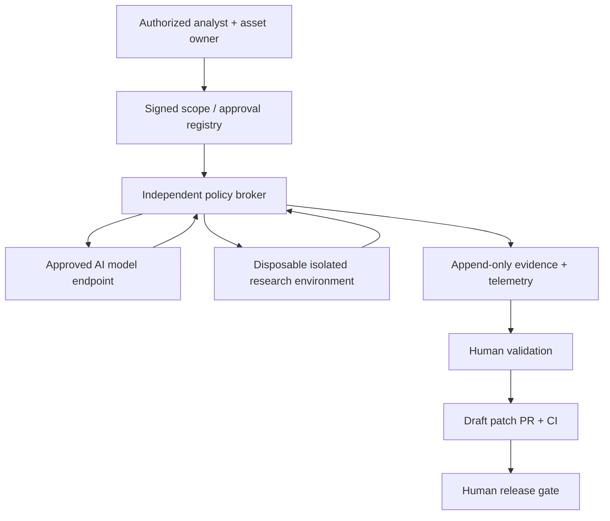

# Architecture and Design Decisions — GPT-6 Cyber Defensive Research Pipeline

**Date:** 2026-11-06  
**Status:** Proposed reference architecture; not deployed, benchmarked or endorsed by OpenAI.  
**Scope:** Authorized, defensive research on owned repositories and isolated labs.

## Context diagram

## ADR-01 — Enforce scope outside the model
**Decision:** Use a signed authorization registry and policy broker to validate every target and action. **Rationale:** Prompt-based obedience and benchmark scores cannot provide an enforceable security boundary. **Alternative:** Agent system prompt only. **Trade-off:** Additional operational complexity and occasional blocked legitimate actions. **Failure mode:** Broker bypass or stale authorization; require deny-by-default and short expiry.

## ADR-02 — Disposable sandbox per task
**Decision:** Execute tools in short-lived VMs or containers with default-deny network access. **Rationale:** Limits lateral movement, persistence and accidental access. **Alternative:** Shared persistent runner. **Trade-off:** Startup overhead and higher compute consumption. **Failure mode:** Misconfigured host mounts or network policies; validate with independent isolation tests.

## ADR-03 — Separate model reasoning from execution
**Decision:** Model proposes actions; a constrained tool gateway performs only approved operations. **Rationale:** Prevents model text from becoming unrestricted shell authority. **Alternative:** Direct shell/SSH access. **Trade-off:** Reduced flexibility and more tool integration work. **Failure mode:** Overly broad gateway verbs; review schemas and authorization at each call.

## ADR-04 — Short-lived credentials
**Decision:** Use task-scoped identities and expiring tokens managed by the broker. **Rationale:** Reduces impact of prompt injection and artifact leakage. **Alternative:** Shared static service token. **Trade-off:** Token issuance and renewal complexity. **Failure mode:** Secrets embedded in logs; redact and audit.

## ADR-05 — Independent evidence and reproducibility
**Decision:** Require reproducible test cases, immutable evidence and analyst validation before a finding is accepted. **Rationale:** Reduces false positives and supports disclosure. **Alternative:** Accept model-written vulnerability narratives. **Trade-off:** Higher analyst effort. **Failure mode:** Flaky tests; pin revisions and record environment versions.

## ADR-06 — Human-controlled remediation
**Decision:** AI may create draft patches, but cannot merge or deploy. **Rationale:** Prevents unsupervised production changes. **Alternative:** Auto-merge when CI passes. **Trade-off:** Slower response to urgent issues. **Failure mode:** Rubber-stamp reviews; require named approvers and risk-based checks.

## ADR-07 — Model-agnostic integration
**Decision:** Abstract model access behind an adapter with explicit capability and policy flags. **Rationale:** GPT-6 Cyber is restricted and alternative models may be needed for labs. **Alternative:** Hard-code Daybreak Red APIs. **Trade-off:** Some vendor-specific functionality may be unavailable. **Failure mode:** Misrepresenting substitute-model results as GPT-6 Cyber results; tag every run with provider and model version.

## ADR-08 — Measure defensive outcomes, not only exploit scores
**Decision:** Compare validated findings, time to fix, false positives, costs and policy violations against a human or conventional-tool baseline. **Rationale:** Vendor benchmark success does not directly measure operational value. **Alternative:** Select model solely by ExploitGym ranking. **Trade-off:** Longer evaluation period. **Failure mode:** Cherry-picked tasks; pre-register and version evaluation sets.

## Threat model

Assets at risk: source code, credentials, research artifacts, production systems, customer data, and disclosure timelines. Threats: prompt injection in repository files, malicious dependencies, unauthorized target pivoting, token exfiltration, unsafe patches, model hallucination and overbroad operator permissions. Controls: signed scope, isolated execution, scoped identities, egress denial, audit trails, reproducibility checks and human approval. Residual risks require security review.

## Sources
- https://openai.com/index/introducing-gpt-6-cyber/
- https://deploymentsafety.openai.com/gpt-6-cyber
