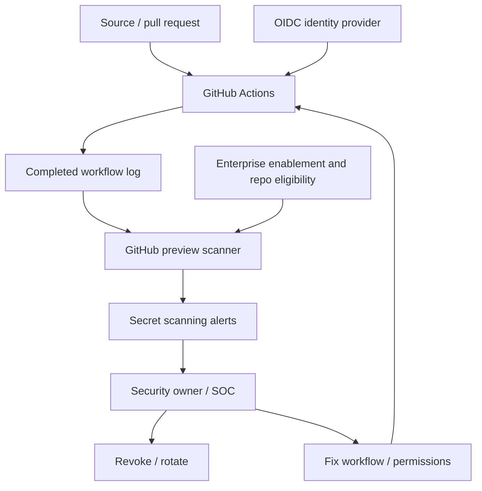
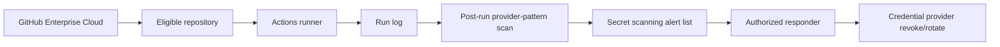

# Architecture and design decisions — Actions log secret scanning (2026-11-10)

**Status:** proposed defensive reference design; not a deployed or benchmarked system.  
**Primary announcement:** https://github.blog/changelog/2026-11-09-secret-scanning-detects-secrets-in-github-actions-workflow-logs/

| ID | Decision and rationale | Alternative | Trade-off / validation |
|---|---|---|---|
| ADR-01 | Prefer OIDC federation and short-lived, narrowly scoped cloud credentials to persistent CI keys; reduces standing exposure. | Store long-lived provider secrets in GitHub Secrets. | OIDC requires IAM trust configuration and provider support; validate subject claims and role scope. |
| ADR-02 | Enable GitHub's post-run Actions-log scan for eligible enterprise repos as a *detection* layer. | External log scanner only. | Preview licensing, provider-pattern scope and post-completion timing; do not claim prevention or historical coverage. |
| ADR-03 | Apply least-privilege `GITHUB_TOKEN` permissions per workflow/job. | Default broad permissions. | Extra configuration and possible CI failures; test required scopes. |
| ADR-04 | Use human-approved rotation and incident triage with auditable runbooks. | Automatically rotate every flagged credential. | Slower response but avoids unsafe automated revocation of shared credentials; automate only after provider-specific testing. |
| ADR-05 | Keep independent artifact, external log-sink and historical-log review. | Rely exclusively on new preview. | More operational work, but preview covers only eligible completed Actions logs after activation. |
| ADR-06 | Use synthetic, invalid fixtures for public demos; never leak a valid key to force a match. | Create a real token and print it. | Cannot guarantee a visible alert in demo; protects viewers and infrastructure. |
| ADR-07 | Use a repository security-owner review cadence while preview notifications are absent. | Wait for email/webhook alerts. | Manual burden; track triage SLAs and verify current product behavior. |
| ADR-08 | Track coverage and response latency, not fabricated detection percentages. | Claim full coverage or universal success. | Less flashy content, but reproducible and defensible. |

## Context diagram

## Trust boundaries

The workflow execution environment may execute untrusted dependency code; do not give it more credentials than necessary. The log is an output surface that can expose secrets before a post-run detector processes it. SOC staff should receive alert metadata rather than copied credential values. Provider revocation is a separate privileged operation with its own audit trail.

## Deployment diagram

These diagrams describe a conceptual flow and **do not** claim access to GitHub's internal implementation or an actual customer deployment.
