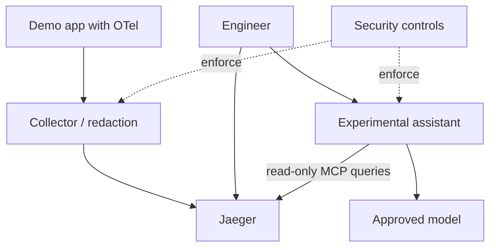

# Architecture decisions — Jaeger AI observability lab (2026-11-11)

**Status:** Proposed educational reference architecture; not implemented or benchmarked. Source announcement: https://www.cncf.io/blog/2026/11/10/jaeger-previews-ai-assisted-troubleshooting-and-genai-observability-for-opentelemetry-traces-at-kubecon/

| ID | Decision and rationale | Alternative | Trade-off / validation |
|---|---|---|---|
| ADR-01 | Use OpenTelemetry instrumentation and Collector as the telemetry boundary. Standard protocol, centralized filtering. | Direct app-to-Jaeger export. | Extra component and operational overhead; test export compatibility. |
| ADR-02 | Redact/allowlist attributes before storage and AI retrieval. Limits accidental disclosure. | Rely only on UI-side filtering. | Can remove diagnostic detail; test synthetic sensitive values. |
| ADR-03 | Isolate demo in dedicated namespace/network and use synthetic traffic. Limits blast radius. | Shared production environment. | Less representative; explicitly avoid claims of production readiness. |
| ADR-04 | Give AI assistant read-only MCP tracing access. Prevents unintended remediation. | Autonomous incident actions. | Human intervention required; verify effective tool permissions. |
| ADR-05 | Use progressive evidence retrieval. Reduces exposure and irrelevant context. | Send entire traces to model. | Additional tool round trips; compare quality and latency. |
| ADR-06 | Keep model endpoint replaceable and egress-restricted. Supports data-residency and cost choice. | Fixed hosted model. | More integration complexity; check ACP/MCP compatibility per version. |
| ADR-07 | Require human evidence verification before incident conclusions. Prevents treating hallucinations as fact. | Trust AI explanation. | Slower workflow; evaluate accuracy against known injected faults. |
| ADR-08 | Separate tracing availability from AI integration. Preserve manual diagnosis on agent failure. | Couple Jaeger availability to model service. | More fallback testing; simulate endpoint outages. |
| ADR-09 | Set bounded retention, sampling and access logs. Manage cost and compliance. | Unlimited full-fidelity tracing. | Potential missing traces; document sampling and replay constraints. |

## Context diagram

## Validation gates

Confirm upstream version and sidecar instructions; verify synthetic-secret redaction; prove assistant cannot modify workloads; compare known-fault diagnosis with manual baseline; test model outage and trace-retention policy. Do not present this design as a deployed system.
