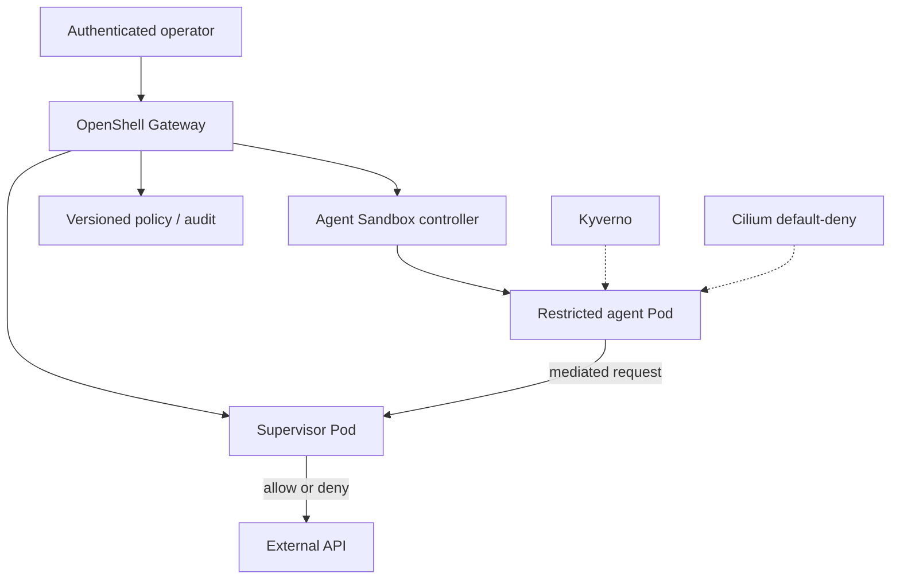

# Architecture Decision Record: OpenShell on Kubernetes Agent Security
**Date:** 2026-11-12 | **Status:** Proposed educational reference architecture, NOT deployed or independently validated.

## Context
AI agents execute untrusted content with tool and network privileges. The CNCF November 11 guide describes an OpenShell gateway/supervisor architecture using Agent Sandbox, Cilium, and Kyverno. This document records decisions for a hypothetical controlled lab, not product security assurances.

| ID | Decision | Rationale | Alternative | Trade-off / verification |
|---|---|---|---|---|
| ADR-01 | Default-deny workload egress via enforced CNI policy | Limit direct agent network reachability | Broad pod egress allowlist | Requires CNI with tested egress enforcement; policy mistakes may break legitimate tasks |
| ADR-02 | Route agent requests through per-agent supervisor | External enforcement with executable/HTTP-method context | Shared proxy or direct pod traffic | Stronger isolation but supervisor pod memory and scheduling overhead |
| ADR-03 | Gateway owns sandbox lifecycle | One authenticated policy/control interface | Direct Kubernetes API creation | Additional gateway availability and identity dependencies; no native OpenShellSandbox CRD yet |
| ADR-04 | Apply Kyverno admission plus post-admission checks | Catch unsafe pod settings and webhook mutation | Admission checks only | Duplicate controls increase complexity but defend against drift |
| ADR-05 | Inject scoped credentials at supervisor, not agent | Reduce raw credential exposure | Kubernetes Secrets mounted in workload | Requires trusted supervisor and careful provider destination rules |
| ADR-06 | Pin image digests and compatible controller versions | Reproducible and auditable builds | Floating latest tags | Patch management and compatibility updates require deliberate work |
| ADR-07 | Keep workloads in dedicated constrained namespaces | Limit blast radius and simplify policy | Shared application namespace | Namespace isolation alone is insufficient; enforce RBAC and quotas |
| ADR-08 | Export allow/deny events to central audit | Explain and investigate attempted tool actions | Local logs only | Retention, privacy, and cardinality costs; redact secrets |
| ADR-09 | Human approval for privileged actions; benchmark scale | Avoid autonomous destructive changes and untested capacity assumptions | Fully autonomous policy mutation and scaling | Adds latency; collect measured startup, CPU, memory, throughput, and denial accuracy |

## Control/data path

## Validation gates
1. Test denied direct egress and allowed supervisor-only paths.
2. Test approved GET versus denied POST in a disposable test repository.
3. Confirm no real credential appears in agent process environment or logs.
4. Attempt unsafe admission mutation and verify fail-closed behavior.
5. Collect per-agent supervisor resource usage and restart behavior.
6. Obtain a security review before considering production.

## Sources
- https://www.cncf.io/blog/2026/11/11/openshell-on-kubernetes-a-guide-for-platform-engineers/
- https://www.cncf.io/announcements/2026/11/10/cncf-hits-major-milestones-with-global-community-growth-record-industry-investment-and-a-new-generation-of-projects-to-build-ai-systems-in-production/
- https://github.com/nirmata/demo-openshell
- https://github.com/NVIDIA/OpenShell
