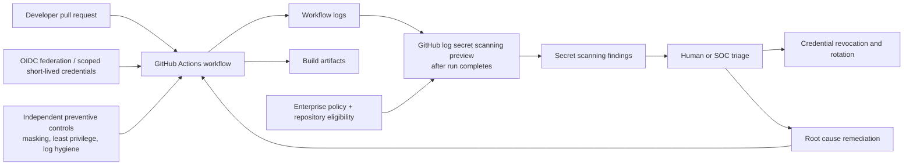

# GitHub Now Scans Actions Logs for Leaked Secrets: What DevSecOps Teams Must Do

**Suggested YouTube title:** GitHub Can Now Find Secrets in CI Logs — But 5 Gaps Still Matter  
**Suggested thumbnail:** “YOUR CI LOGS LEAK KEYS?”  
**Audience:** DevSecOps engineers, GitHub Enterprise administrators, platform engineers, SOC analysts.  
**Suggested video:** 10–15 minutes, screen walkthrough plus synthetic test.  
**News trigger:** GitHub's official changelog dated **November 9, 2026**.

## Executive summary

GitHub announced a **public preview** that extends secret scanning to completed GitHub Actions workflow logs. This closes a meaningful visibility gap: credentials may leak through command output, debugging, misconfigured scripts, and third-party actions even when source code contains no secret. But this is **not** a universal leak-prevention system: the preview is enterprise-scoped, opt-in, scans only new completed runs, and excludes several detection classes. The most useful tutorial is therefore a *layered defense* demonstration, not a claim that GitHub automatically protects all CI logs.

## What GitHub actually announced

According to GitHub's November 9 changelog, when a workflow run finishes, GitHub checks its logs for supported **provider patterns**. Matches appear in the repository's existing secret-scanning alerts with links to the relevant log. Supported secret types can receive validity checks. Alerts persist even if the underlying log is subsequently deleted.

**Eligibility:** GitHub Enterprise Cloud enterprises with GitHub Secret Protection or GitHub Advanced Security, including supported GHE.com data-residency enterprises. Enterprise owners enable the preview under **Enterprise settings → Policies → Advanced Security**, selecting **Enabled** for Actions workflow log scanning. The setting is disabled by default; only repositories with the relevant secret scanning already enabled are covered. Verify the exact UI labels in your enterprise because previews evolve.

**Five important gaps:**
1. **No backfill:** logs from runs completed before enablement are not scanned.
2. **No generic/custom patterns:** only supported provider patterns are included.
3. **No AI-detected secrets:** the AI detector is not part of this preview.
4. **Masked secrets are excluded:** do not assume masked text is checked by this detector.
5. **No preview alert notifications:** teams must inspect the secret-scanning alert list themselves.

Do not confuse detection after workflow completion with prevention of a credential being printed in the first place. A credential exposed in a log may already have been accessed.

## Why CI logs become an attack surface

Build scripts may print environment variables, enable verbose HTTP tracing, include authentication headers in errors, or emit third-party tool diagnostics. Artifacts and logs can be copied into tickets or external monitoring systems. A short-lived credential reduces exposure, but does not eliminate the need to contain it when leaked. Log permissions, retention and access controls remain separate concerns from secret detection.

## Reference architecture (proposed, not a verified GitHub deployment)



The architecture separates **prevention** (identity and workflow design) from **detection** (post-run scanning) and **response** (revocation, root cause and verification). It is a conceptual reference design; exact provider behavior, enterprise licensing and permissions require validation in your environment.

## Safe implementation walkthrough

### 1. Establish eligibility and ownership

Confirm your enterprise license, data-residency setting, repo secret-scanning coverage and ownership of the enterprise-level policy. Record the activation time because pre-existing logs will not be backfilled. Document which repositories are in scope and which are not.

### 2. Enable the preview and establish an alert-review routine

An enterprise owner enables the setting in enterprise Advanced Security policies. Assign a repository security owner or SOC queue to **check secret scanning alerts directly** during the preview; do not rely on notifications. Capture the alert URL, repository, workflow run, detected provider type and timestamps in your incident record without copying the secret itself.

### 3. Demonstrate with a synthetic value, not a real credential

Use a **non-secret, clearly invalid fixture** in a disposable test repository to demonstrate ordinary log output and explain why a fake string may not trigger provider-pattern detection. Never deliberately print a valid token merely to force a detection. For an actual alert walkthrough, use a pre-existing sanitized screenshot or an authorized test environment with approved sacrificial credentials, immediate revocation and no external exposure. Never publish an unredacted alert or log.

### 4. Review workflow permissions

Prefer GitHub Actions OIDC federation with cloud IAM rather than long-lived cloud access keys. Restrict `GITHUB_TOKEN` permissions at the workflow or job level, pin third-party actions to trusted commit SHAs where practical, separate privileged deployment jobs from untrusted pull requests, and avoid passing sensitive credentials to untrusted code.

Illustrative least-privilege workflow (adapt to your repository):

```yaml
name: ci
on:
  pull_request:
permissions:
  contents: read
jobs:
  test:
    runs-on: ubuntu-latest
    steps:
      - uses: actions/checkout@<REVIEWED_FULL_COMMIT_SHA>
      - name: Run tests
        run: ./scripts/test.sh
```

The placeholder must be replaced with a reviewed immutable commit SHA; this example is **not** copy-paste runnable as written. Avoid `set -x` around commands handling secrets, avoid echoing token-bearing URLs and inspect third-party action output behavior.

### 5. Respond to a finding

Treat a potentially exposed valid credential as compromised until triaged. Determine scope and validity; **revoke or rotate** using the provider's recommended procedure; review access logs for suspicious use; check downstream systems, artifacts and copied logs; fix the workflow; rerun with sanitized output; and document closure. Deleting a log is not credential revocation and does not erase the secret-scanning alert.

### 6. Measure without fabricating impact

Track *time from workflow completion to triage*, *time to revocation*, *covered repositories / eligible repositories*, *alerts by provider type*, and *repeat leaks*. Establish a baseline before claiming improvement. Do not interpret zero alerts as proof of zero leakage.

## Architectural decisions

See [the separate design-decisions document](../architecture/2026-11-10-actions-log-secret-scanning-design-decisions.md) for explicit rationale, alternatives and trade-offs. In brief: use OIDC where supported; preserve post-run scanning as a detection layer; keep incident response human-controlled; minimize token scope; maintain separate controls for artifacts and historical logs; and avoid assuming preview coverage equals comprehensive security.

## Production caveats

- This is a **public preview**, not a generally available control for all GitHub accounts.
- Provider patterns and supported validity checks are not equivalent to universal secret detection.
- A completed-run scan may detect a secret only *after* exposure.
- Logs from before enablement are excluded; use authorized historical review processes if necessary.
- Enterprise policies and pricing may change; check current vendor documentation before recording the video.
- A demonstration with fake secrets may produce **no alert**; this is expected and must not be presented as a failed or successful live detection benchmark.
- No YouTube search-volume, creator-supply or competition metric was independently established. The specialized tutorial angle is a hypothesis worth testing with YouTube Studio data.

## Video outline

**0:00–0:45** The risk: secrets in logs, not just code.  
**0:45–2:30** Exactly what GitHub launched on November 9.  
**2:30–4:00** Enterprise eligibility and opt-in.  
**4:00–6:00** Five preview limitations.  
**6:00–9:00** Safe workflow hardening, OIDC and permissions.  
**9:00–12:00** Triage and rotation playbook.  
**12:00–end** Audit checklist and invitation to test coverage.

**Suggested description:** GitHub introduced secret scanning for completed Actions workflow logs in public preview on November 9, 2026. Learn who can enable it, what it misses, and how to harden CI/CD pipelines using least privilege, OIDC, log hygiene and a credential incident-response playbook.

**CTA:** Subscribe for practical DevSecOps labs; download the companion architecture and checklist from the linked GitHub repository.

## References (primary sources)

1. GitHub Changelog, **November 9, 2026**, “Secret scanning detects secrets in GitHub Actions workflow logs”: https://github.blog/changelog/2026-11-09-secret-scanning-detects-secrets-in-github-actions-workflow-logs/
2. GitHub documentation, secret scanning overview (living documentation; verify latest): https://docs.github.com/en/code-security/secret-scanning/introduction/about-secret-scanning
3. GitHub documentation, automatic token authentication and permissions (living documentation): https://docs.github.com/en/actions/security-for-github-actions/security-guides/automatic-token-authentication
4. GitHub documentation, OIDC for cloud deployments (living documentation): https://docs.github.com/en/actions/security-for-github-actions/security-hardening-your-deployments/about-security-hardening-with-openid-connect

**Editorial verification note:** Only the November 9 GitHub changelog is used as evidence of this *new* preview. Documentation URLs are background guidance and should be checked for redirects before publication.
