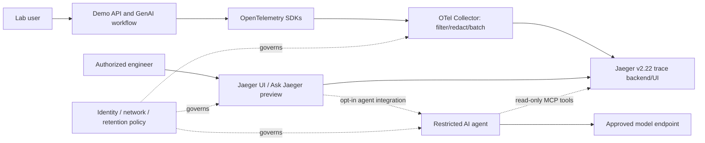

# Jaeger 2.22 Adds AI Troubleshooting: Build a Safer OpenTelemetry Observability Lab

**YouTube title:** *Jaeger Just Added an AI Debugger — Can It Explain Your Kubernetes Outage?*

**SEO keywords:** Jaeger 2.22 AI, Ask Jaeger, Jaeger MCP, OpenTelemetry GenAI, AI observability, SRE troubleshooting, Kubernetes tracing.

**Audience:** SREs, DevOps/platform engineers, cloud architects, developers running agentic applications.

**Editorial note (11 November 2026):** Jaeger maintainers announced this experimental preview on **10 November 2026**. Demand is plausible given the growing use of GenAI observability, but no verified YouTube search-volume, creator-supply, or competition statistics were obtained. This is a differentiated tutorial hypothesis, not a quantified low-competition finding.

## What changed

At KubeCon + CloudNativeCon North America 2026, Jaeger maintainers previewed AI-assisted troubleshooting and GenAI-aware trace visualization in **Jaeger v2.22**. The new preview includes **Ask Jaeger**, an in-product conversational assistant with visible tool calls; an **opt-in MCP endpoint with nine focused tools**; diagnostic skills for error root-cause investigation and N+1 queries; and trace views informed by OpenTelemetry GenAI semantic conventions. These features are **experimental**, not an assurance of production stability or automated incident resolution.

The MCP tools let an agent progressively discover services and traces, examine errors, topology, critical paths and individual spans. This matters because handing a model every span from a long trace increases data exposure and cost. Instead, a diagnostic assistant can retrieve narrower evidence and show its reasoning trail.

The Jaeger project describes integration of MCP, ACP and AG-UI, with replaceable agent components. Do not confuse interoperability with a security guarantee: MCP tools still need authentication, authorization, rate limiting and data controls appropriate to their deployment.

## Why engineers should care

Conventional distributed tracing correlates service calls, latency and errors. An AI service introduces model invocations, retrieval, agent/tool execution and token usage. A single user-visible failure may span application code, vector retrieval, inference gateway, external tools and downstream APIs. OpenTelemetry GenAI semantic conventions provide a vocabulary for instrumenting some of those steps, while Jaeger offers a way to inspect them alongside ordinary service spans.

The preview is compelling because the operator can ask a question, inspect the assistant's tool calls, and verify its claims against actual spans. **An AI diagnosis is a hypothesis, not a root-cause verdict.**

## Proposed educational lab architecture

The diagram below is a **reference design proposed for a lab**, not a diagram of Jaeger's internal deployment or a claim that this configuration has been tested.

For a Kubernetes version, run the demo and Collector in a dedicated namespace with NetworkPolicies, restrictive service accounts and resource quotas. Keep Jaeger UI and MCP access private behind authenticated access; use synthetic traces only. The preview's exact installation flags and sidecar configuration may change: follow the version-specific upstream guide rather than copying speculative commands.

## Hands-on tutorial plan

### 1. Create a synthetic failure

Build a small demo API with three steps: HTTP request → mock retrieval → mock model call. Instrument each step with OpenTelemetry spans. Add controlled latency to the retrieval step and a deterministic error in the model-call step. Use **dummy prompts and dummy identifiers**; do not send real credentials or customer conversations into the lab.

### 2. Route telemetry through a Collector

Configure the Collector to accept OTLP telemetry from the demo, redact sensitive attributes, batch spans and export to Jaeger using the transport supported by your selected version. Confirm connectivity and exporter compatibility using official documentation. Do not assume that all Jaeger distributions accept the same ports or exporters.

### 3. Inspect traces manually first

Find the failed request, inspect span timings and error attributes, and identify which service dominates the critical path. Record a manual baseline diagnosis before involving an assistant. This makes the later AI comparison meaningful.

### 4. Enable the experimental AI integration

Install Jaeger **v2.22 or later** and follow the official AI sidecar integration instructions for the precise release. Enable the opt-in MCP interface only inside the isolated lab. Grant the assistant read-only access to telemetry; keep incident remediation and infrastructure mutation outside its permissions.

### 5. Compare evidence with the assistant's answer

Ask: “Which step explains the latency spike?” and “Which span first reported the error?” Check whether the assistant names the right trace, cites relevant span evidence, distinguishes correlation from causation, and acknowledges uncertainty. Repeat with an N+1 query pattern. Log response time, model usage if exposed, and any missing evidence; do not invent accuracy or speed gains.

### 6. Exercise privacy and failure handling

Insert a synthetic secret-like string in a demo attribute and verify the Collector's redaction **before** exposing any telemetry to the assistant. Test agent timeouts, unavailable model endpoint, denied MCP access and high-cardinality attributes. Confirm that manual trace inspection remains possible when AI components are offline.

## Security and operational caveats

* **Experimental status:** Ask Jaeger and its integrations are preview capabilities. APIs and setup may change.
* **Sensitive trace content:** Prompts, model outputs, tool arguments, system instructions and headers can contain personal or proprietary information. Instrument selectively and redact before export.
* **Prompt injection:** Traces may contain attacker-controlled text. Treat span values as untrusted data, never as instructions for the assistant.
* **Least privilege:** A troubleshooting agent should not have cloud-admin permissions, production write access or unrestricted network egress.
* **Cost and retention:** Sampling, cardinality, model usage and trace retention all affect cost. Measure rather than assume.
* **Verification:** An LLM can misinterpret causality or hallucinate explanations. Operators must inspect raw evidence.
* **Interoperability:** GenAI semantic conventions evolve; check instrumentation-library and backend compatibility.

## Architecture choices

See [design decisions](../architecture/2026-11-11-jaeger-ai-observability-design-decisions.md) for rationale, alternatives and trade-offs. The central decisions are Collector-first data minimization, read-only MCP, isolated lab namespace, explicit human verification, and replaceable model integrations.

## Suggested YouTube structure (10–14 minutes)

1. **Hook:** A failing agent workflow with a confusing trace (0:00–0:45).
2. **News:** What Jaeger maintainers actually announced on 10 November (0:45–2:00).
3. **Architecture:** Show the lab data path and trust boundaries (2:00–4:00).
4. **Demo:** Manual trace investigation, then Ask Jaeger comparison (4:00–9:00).
5. **Security:** Redaction, untrusted span text and read-only MCP (9:00–11:30).
6. **Verdict:** Experimental status, measurable evaluation criteria and next steps (11:30–14:00).

**Thumbnail concept:** “AI DEBUGS TRACES?” with a stylized trace waterfall; avoid implying a tested result until footage exists.

**Monetization path:** educational OpenTelemetry/Jaeger workshops, SRE observability training, consulting for instrumenting AI workloads. Avoid claiming a vendor endorsement.

## References (primary sources; accessed 11 November 2026)

1. Jaeger maintainers / CNCF, **10 November 2026**, “Jaeger Previews AI-Assisted Troubleshooting and GenAI Observability for OpenTelemetry Traces at KubeCon”: https://www.cncf.io/blog/2026/11/10/jaeger-previews-ai-assisted-troubleshooting-and-genai-observability-for-opentelemetry-traces-at-kubecon/
2. Jaeger project documentation: https://www.jaegertracing.io/docs/
3. Jaeger source and release tags: https://github.com/jaegertracing/jaeger
4. OpenTelemetry GenAI semantic conventions: https://opentelemetry.io/docs/specs/semconv/gen-ai/
5. OpenTelemetry Collector documentation: https://opentelemetry.io/docs/collector/
6. Jaeger official site: https://www.jaegertracing.io/

**Fact-check boundary:** The 10 November announcement establishes preview features, not measured diagnosis accuracy, cost savings, safe production deployment, or YouTube audience demand.
