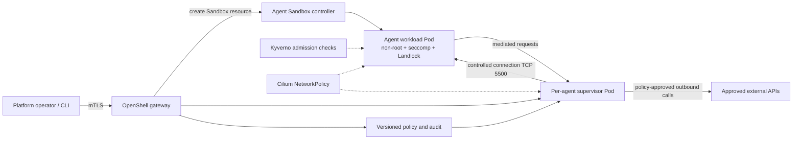

# OpenShell on Kubernetes: Secure AI Agents Beyond NetworkPolicy

**Recommended YouTube title:** **Your Kubernetes NetworkPolicy Can't Stop This AI Agent — OpenShell Explained**

**Publication trigger:** On **November 11, 2026**, Nirmata's Jim Bugwadia published a detailed CNCF engineering walkthrough of OpenShell's Kubernetes control path, enforcement architecture, and a reproducible demo stack. CNCF had already announced OpenShell's Sandbox participation on November 10; the new technical guide, not the project admission alone, is the distinct newsworthy development.

**Audience:** Kubernetes platform engineers, SREs, DevSecOps, AI-agent builders, security architects. **Opportunity hypothesis:** A concrete security lab comparing pod-level egress with per-process/per-method enforcement is more distinctive than a generic KubeCon recap. No reliable YouTube search volume, competing-video count, or demand-growth statistic was verified. Treat low competition as unproven.

## Why conventional pod isolation is not enough

An autonomous agent can read external text, execute shell commands, install packages, and call APIs using credentials. A Kubernetes NetworkPolicy can restrict pod-to-pod and IP/port connectivity, but it cannot ordinarily distinguish a GET request made by `curl` from a POST request to create an issue at the same HTTPS endpoint. This is a difference in **authorization granularity**, not evidence that Kubernetes NetworkPolicy is defective.

OpenShell, originating with NVIDIA and now a CNCF Sandbox project, provides a sandbox runtime with a trusted supervisor that mediates access to resources and destinations. The November 11 CNCF tutorial documents four control areas: Landlock-based filesystem restrictions; non-root/capability/seccomp process constraints; deny-by-default network policies with finer-grained executable/host/port/HTTP-method rules; and credential placeholders substituted by the supervisor for approved providers.

**Maturity warning:** CNCF Sandbox status is not production certification. The November 11 walkthrough is a contributor-authored example, not a universally verified security guarantee.

## Reference architecture (proposed educational deployment)

*Diagram is conceptual and based on the CNCF walkthrough. It is not a claim that this architecture has been deployed by the author. The supervisor-mediated control/data paths should be checked against the specific OpenShell release.*

### Documented Kubernetes lifecycle

1. Prepare a cluster with working ingress **and** egress NetworkPolicy enforcement; the published demonstration uses a two-node `kind` cluster and Cilium.
2. Install Agent Sandbox controller/CRDs and the OpenShell gateway chart, using pinned compatible versions.
3. Request sandbox creation via the OpenShell gateway API over mTLS. **At the time of the article, sandbox creation does not use a native OpenShellSandbox Kubernetes CRD**; the source identifies an open issue for this.
4. The driver creates or validates namespace network restrictions **before** creating the suspended Sandbox resource.
5. Agent Sandbox creates the workload Pod and PVC with a scheduling gate.
6. OpenShell reads back the admitted Pod and checks UID/GID, capabilities, seccomp, namespaces, service-account tokens, labels, and volumes. Unexpected mutation fails creation.
7. The driver creates the supervisor Pod, Service, and bootstrap/TLS Secrets; scheduling gates are released only after setup.
8. Supervisor authenticates to the gateway, obtains policy, connects to the workload, and permits execution after sandbox controls are confirmed.
9. Outbound requests traverse the supervisor; it can deny by executable, destination, port, and HTTP method. Policy updates can apply without restarting the sandbox.
10. Stopping preserves the PVC while removing the workload Pod; deletion cleans owned resources. Understand retention and rollback semantics before production use.

The contributor's **specific example versions** are Kubernetes 1.35, Cilium 1.20, Agent Sandbox v1.0.5, OpenShell 0.1.3, and Kyverno 1.18.2. These are **example versions**, not recommendations to deploy unreviewed in production.

## Safe lab: prove the policy boundary

Use the published `nirmata/demo-openshell` repository in an isolated disposable cluster. Review manifests, Helm charts, image digests, and RBAC before execution. Do not use real production credentials.

**Test A — deny by default:** Launch a disposable agent sandbox with no provider credentials. Attempt an outbound HTTPS request to an unapproved endpoint; verify the request is denied and logged.

**Test B — least privilege:** Apply a version-controlled policy allowing a narrow read-only request to an approved GitHub API endpoint. Verify a GET succeeds and a POST to `/issues` is denied. The source's demo describes exactly this distinction; your own results must be recorded before making claims about the lab.

**Test C — credential containment:** Use a revocable test token with minimal scope. Confirm the agent receives a placeholder rather than the raw credential and that only approved provider destinations receive substituted secrets. Check logs for accidental exposure.

**Test D — admission drift:** In a non-production namespace, simulate an admission mutation that would add an unsafe setting. Verify OpenShell's post-admission validation fails closed; restore the configuration.

**Test E — operations:** Measure sandbox startup latency, memory overhead per supervisor, audit completeness, and policy-update behavior. These are **measurements to collect**, not published benchmark outcomes.

### Suggested video chapter structure

00:00 The API call NetworkPolicy cannot distinguish; 01:20 November 11 CNCF guide; 03:00 gateway vs supervisor; 05:30 Cilium + Kyverno + Agent Sandbox; 08:30 safe GET/POST lab; 12:00 credential mediation; 14:00 costs and scaling; 16:00 architecture decisions and production checklist.

## Threat model and production controls

Treat prompts, retrieved webpages, repository files, and tool outputs as **untrusted input**. Agent instructions are not an authorization boundary. Enforce identity, policy, network restrictions, credential substitution, and resource quotas outside the model process. Use immutable image digests, SBOM and signature checks, namespace isolation, audit retention, alerting on policy denials, and independent human approval for destructive actions. Restrict who can update gateway policy or Kubernetes RBAC. Ensure the CNI actually enforces egress rules; Kubernetes alone does not guarantee a particular CNI implementation.

A supervisor per agent strengthens separation but adds scheduling and memory overhead. The published guide calls out this scaling issue and links an RFC for flexible supervisor deployment. Do not assume the design is suitable for thousands of simultaneous agents without capacity testing.

## OpenShell vs Agent Substrate

Both are CNCF Sandbox-stage efforts, but their emphasis differs. OpenShell's central concern is **what an agent may access and do** through external policy mediation; its Kubernetes backend uses the SIG Apps Agent Sandbox resource. Agent Substrate emphasizes **economical, isolated execution for large numbers of mostly idle agents** and uses its own worker/actor model. These are not drop-in replacements. Evaluate lifecycle, control-plane ownership, policy expressiveness, scale, integration maturity, and operational burden.

## Architecture decisions and trade-offs

See [the separate decision record](../architecture/2026-11-12-openshell-kubernetes-design-decisions.md) for nine explicit decisions, alternatives, rationale, and risks. In summary: default-deny egress; separate supervisor from workload; pin images and policies; use short-lived scoped credentials; keep admission checks independent; deploy in a dedicated namespace; make auditing mandatory; keep humans in charge of privileged changes; and benchmark supervisor overhead before scaling.

## Limitations and editorial verification checklist

- OpenShell is early-stage and the documented demo may change rapidly.
- Policy enforcement is only as strong as gateway, supervisor, CNI, admission, and identity configuration.
- The described method-level restrictions apply to mediated traffic; do not generalize to every protocol or bypass scenario.
- No independent exploitation testing or production deployment is claimed.
- No verified YouTube search-volume or creator-supply metrics were available.
- Before recording, rerun the lab and capture actual terminal evidence, denial logs, versions, and costs.

## References (primary sources, full URLs)

1. CNCF member post, **November 11, 2026**, *OpenShell on Kubernetes: A guide for platform engineers*: https://www.cncf.io/blog/2026/11/11/openshell-on-kubernetes-a-guide-for-platform-engineers/
2. CNCF announcement, **November 10, 2026**, *CNCF Hits Major Milestones...*: https://www.cncf.io/announcements/2026/11/10/cncf-hits-major-milestones-with-global-community-growth-record-industry-investment-and-a-new-generation-of-projects-to-build-ai-systems-in-production/
3. OpenShell project: https://github.com/NVIDIA/OpenShell
4. Reproducible contributor demo: https://github.com/nirmata/demo-openshell
5. Kubernetes Agent Sandbox project: https://agent-sandbox.sigs.k8s.io/
6. Kubernetes NetworkPolicy documentation: https://kubernetes.io/docs/concepts/services-networking/network-policies/
7. Kyverno documentation: https://kyverno.io/docs/
8. Cilium documentation: https://docs.cilium.io/
