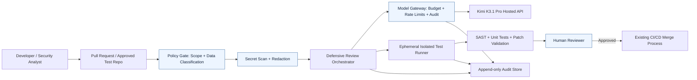

# Kimi K3.1 Pro Removed Its Hacking Training Data — So Why Does It Lead an AI Cybersecurity Benchmark?

*Research checked: 25 October 2026. This is an evidence-based analysis and a proposed defensive reference architecture, not a report of a completed deployment.*

## Executive summary

On **23 October 2026**, Moonshot AI introduced **Kimi K3.1 Pro**, a 3-trillion-parameter-class model with a claimed one-million-token context window. Kimi K3.1 Pro and a faster Highspeed variant are already accessible through Moonshot's hosted products and API. **The full model weights have not yet been released**: Moonshot says they will arrive **by 4 November 2026**. Availability on an API is not the same as an available, self-hostable open-weight release. [1]

Moonshot also reported a deliberate cyber-risk intervention: it removed cybersecurity-related material from its mid-training data and cybersecurity tasks from reinforcement-learning environments. On its own **xdev-bench-hard** exploitation benchmark, an unfiltered checkpoint scored **90.5% pass@3**, while the selected K3.1 Pro model scored **81.0% pass@3**. These are **vendor-reported, not independently validated** results. [1]

Separately, independent evaluator **Artificial Analysis** reports Kimi K3.1 Pro at **64 points**, the highest score shown on its **defensive Cyber Index**, ahead of DeepSeek V4.1 Flash 1017 (57) and Grok 4.7 (56). Its Cyber Index explicitly **does not test building working exploits**. [2]

There is no contradiction: removing some offensive-specialist training can reduce performance on one exploitation benchmark while leaving a model highly effective at code review, vulnerability diagnosis and patching. The numbers **81.0% and 64 are not comparable**, because they come from different tests, tasks and scoring methods.

**Editorial conclusion:** This is a timely opportunity to explain the difference between *offensive capability*, *defensive capability*, *model access*, and *secure agent deployment* — without presenting benchmark rankings as guarantees.

## What actually changed

| Topic | Verified position on 25 October 2026 | Source |
|---|---|---|
| Product launch | Kimi K3.1 Pro announced 23 October; available through Kimi apps and API | [1], [3] |
| Model family | Moonshot describes a 3T-class model, post-trained from Kimi K3, with a 1M-token context | [1] |
| Highspeed | Moonshot claims 2–3× the speed of standard K3.1 Pro | [1] |
| Weights | **Promised by 4 November**, not publicly available as of this review | [1], [3] |
| Cyber filtering | Removed cyber-related content from mid-training and cyber-related RL tasks | [1] |
| Internal offensive test | Unfiltered 90.5%; filtered K3.1 Pro 81.0%, xdev-bench-hard pass@3 | [1] |
| Independent defensive test | K3.1 Pro leads Artificial Analysis Cyber Index at 64 points | [2] |
| API pricing | $2 per million input tokens and $10 per million output tokens, subject to provider changes | [3], [4] |

The headline should **not** say the model is "safe from hacking" or "unable to exploit vulnerabilities". Moonshot's own figures describe a *relative reduction* in a measured capability, not its elimination.

## Understanding the two cyber benchmarks

### Moonshot's xdev-bench-hard: exploitation in a controlled setting

Moonshot describes xdev-bench-hard as an internal benchmark using vulnerable source code, a hint and a binary. The model must produce an exploit, obtain code execution inside a separate sandbox and retrieve a verification secret. The company reports **pass@3**, allowing multiple attempts, with no hard timeout or output-token cap. The benchmark draws on recreated vulnerabilities in software including the Linux kernel and Node.js. [1]

That is an **offensive capability evaluation**, although conducted in controlled environments. The difference between 90.5% and 81.0% is **9.5 percentage points** on this internal test. It does not establish a 9.5% reduction in real-world cybercrime, and it is not evidence that the model cannot be misused.

### Artificial Analysis Cyber Index: find, validate and fix

Artificial Analysis combines three independently administered defensive evaluations: **CWE-Bench-AA**, **DeepsecBench-AA** and **CyberGym-E2E-AA**. The index measures a loop of locating weaknesses, reproducing or validating issues, and producing patches without breaking existing behavior. Its score is the equally weighted mean of the three component scores after normalization to a 0–100 scale. Artificial Analysis says **exploit realization is out of scope**. [2]

Thus **64 is an index score, not "64% of hacks succeeded"**. The index's public results currently place K3.1 Pro ahead of the other models listed, but scores may change as evaluators update models and methods.

### Why both results can be true

- General software reasoning, debugging and tool use transfer to both offensive and defensive security tasks.
- Filtering specific training material can reduce some measured exploit-development performance without removing general code-understanding skills.
- The internal offensive and independent defensive tests differ in objective, datasets, harnesses, retry budgets and scoring.
- Benchmark performance says little by itself about deployment safety: tools, credentials, network access and approval workflows determine real operational exposure.

A responsible video should display **two separate benchmark cards**, not a single bar chart mixing 90.5, 81.0 and 64.

## Is this a good local or sovereign AI model?

**Not yet a turnkey local deployment.** The hosted K3.1 Pro API is available now; the promised open weights are a future release. Until weights, license, quantization formats and supported inference stacks are published and checked, it is premature to claim successful deployments on Ollama, llama.cpp, vLLM or a particular GPU. [1], [3]

The advertised 3T-class scale suggests substantial infrastructure demands for full-precision hosting. **Active parameters in a mixture-of-experts model are not the same as total stored weights**: sparsity reduces computation per token, not necessarily the memory needed to keep experts available. A million-token *supported context limit* does not mean a million-token prompt will be economical or accurate for every use case.

For a small DevSecOps team, an **API-based, redacted-data pilot** is the credible near-term option. Revisit self-hosting only after the weight release and a hardware, license, latency and cost assessment.

## Reference architecture: controlled defensive code-review agent

The following is a **proposed reference architecture**, not an independently validated Kimi deployment.

Reusable asset: [context architecture diagram](../../../diagrams/2026-10-25-kimi-k31-pro-cyber-paradox-context.svg). Detailed rationale: [architecture and design decisions](../../../architecture/2026-10-25-kimi-k31-pro-cyber-paradox-design-decisions.md).

### Trust boundaries

1. **Repository input is untrusted.** Source comments, issue text and dependencies can contain prompt-injection attempts.
2. **The model is not an authorization authority.** Its text cannot approve network access, deploy software or retrieve secrets.
3. **Test execution is isolated.** Use an ephemeral environment, read-only source checkout where possible, a temporary writable workspace, restricted egress and no production credentials.
4. **The model provider is an external processing boundary.** Only send data permitted by organizational policy; redact secrets and evaluate privacy, retention and contractual controls.
5. **Humans own production changes.** The agent proposes patches; conventional CI and a designated reviewer decide whether they ship.

## A safe 45-minute DevSecOps pilot

This workflow deliberately avoids exploit generation or scanning systems you do not own.

**Prerequisites:** an authorized non-sensitive test repository, a small set of known defensive issues, a sandboxed CI runner, a model API account, and a reviewer. Use **synthetic code** or a public training project for the first run.

1. **Select a bounded task:** e.g., replace a hard-coded test credential, correct an unsafe YAML default, or repair missing input validation in a toy application.
2. **Record a baseline:** run unit tests and a static analyzer before involving the model. Capture tool versions and expected findings.
3. **Prepare context:** provide only the necessary files and instructions; remove credentials, customer data and private infrastructure identifiers.
4. **Request a patch, not shell access:** ask the model to explain the issue, suggest a minimal diff, identify possible regressions and list assumptions. Treat its output as untrusted.
5. **Validate in isolation:** apply the proposed diff in a throwaway branch, run unit tests, static analysis and negative tests. Do not permit the model to self-certify success.
6. **Review manually:** require a human to inspect the change, security implications and test evidence before a PR is accepted.
7. **Log the outcome:** task ID, model ID, prompt template version, token usage, latency, review result and false-positive/false-negative notes. Exclude secrets from logs.
8. **Repeat on a fixed suite:** compare with a baseline model on the same tasks, environment, harness and cost policy.

### Example model-neutral evaluation rubric

| Dimension | Suggested evidence | Failure condition |
|---|---|---|
| Finding quality | Correct issue and affected line(s) | Hallucinated vulnerability |
| Patch correctness | Relevant tests pass | Regression or unchanged vulnerability |
| Scope discipline | Changes limited to authorized files | Unrequested file or dependency changes |
| Security | No secrets, privileged tools or unrestricted egress | Policy boundary violated |
| Explainability | Clear rationale and uncertainty | Unsupported certainty |
| Economics | Cost, latency and reviewer time per accepted patch | Costs exceed agreed budget |

**Pilot acceptance rule (proposed):** Do not deploy the agent in production merely because its benchmark rank is high. Require repeatable, reviewed outcomes on your own representative tasks and a passing policy/security assessment.

## API integration notes and cost discipline

Moonshot lists the model identifiers **`kimi-k3.1-pro`** and **`kimi-k3.1-pro-highspeed`** for its API. Confirm the current request format, limits and model availability against the provider's documentation before implementation. [1], [5]

For an illustrative workload of **200,000 input tokens and 20,000 output tokens**, the published standard-model list rates imply:

- Input: 0.2 × $2 = **$0.40**
- Output: 0.02 × $10 = **$0.20**
- **Illustrative total: $0.60**, excluding other charges, caching effects, retries, infrastructure and human review.

This is **arithmetic from advertised prices**, not a measured task cost or a prediction of typical consumption. Large context windows and multi-step agent loops can drive costs much higher. Set per-run token budgets and maximum tool iterations, and compare **cost per accepted patch**, not only price per million tokens.

## Deployment checklist

- [ ] Confirm current API documentation, model identifier, pricing and privacy terms.
- [ ] Obtain repository-owner permission for every scanned codebase.
- [ ] Use a non-production, synthetic-data pilot before private repositories.
- [ ] Redact credentials and regulated or confidential information before sending prompts.
- [ ] Disable unrestricted network egress from execution sandboxes.
- [ ] Give the agent no production cloud credentials or write access to protected branches.
- [ ] Require code review, CI tests and an explicit approval gate.
- [ ] Measure false positives, false negatives, patch regressions, cost and latency.
- [ ] Reassess licensing and hardware **after** the promised weight publication.
- [ ] Document incidents and have a rollback/kill-switch procedure.

## What remains uncertain

**Vendor claims:** Moonshot's 90.5% and 81.0% are results from an internal benchmark, not an independent replication. Its other benchmark comparisons may use differing harnesses or model settings. [1]

**Independent but narrow:** Artificial Analysis runs its own tests, but the Cyber Index measures defined defensive tasks, not all real-world security operations. It does not validate Kimi's offensive benchmark or guarantee safe deployment. [2]

**Release status:** The company promises weights by 4 November 2026. Do not call K3.1 Pro "downloadable" or "locally tested" until publication is verified. The future license and practical deployment footprint require separate confirmation. [1], [3]

**Security controls:** Training-data filtering is not a replacement for authorization, isolation, monitoring or human approval.

## Suggested YouTube production package

**Title:** Kimi Removed Its Hacking Skills — Yet It Leads AI Cybersecurity Tests?

**Thumbnail:** `HACKING DATA REMOVED?` / `CYBER #1?`

**Opening hook:** "Moonshot says it deliberately weakened its newest AI model at hacking. Yet an independent cybersecurity benchmark puts that same model at the top. Is that a contradiction—or are we measuring two completely different things?"

**Video structure (8–10 minutes):** (0:00) the paradox; (0:45) release and availability; (1:45) offensive xdev-bench-hard vs defensive Cyber Index; (3:45) why the results can coexist; (5:00) proposed sandboxed DevSecOps architecture; (7:00) safe patch-review demo; (8:30) API-versus-self-hosting reality check; (9:30) verdict.

**Audience:** security engineers, DevOps/platform teams, cloud architects, local-AI enthusiasts and engineering managers.

**Monetization fit:** professional training, architecture workshops, security review consulting and vendor-neutral AI evaluation guides. Avoid implying affiliation with Moonshot or Artificial Analysis.

**Demand and supply signal:** The release drew contemporary Reuters coverage and multiple YouTube launch reviews, indicating timely attention. The *narrow technical comparison of offensive versus defensive benchmarks plus secure enterprise workflow* appears less represented in the indexed examples reviewed on 25 October. This is a **qualitative content-gap hypothesis**, not a measured search-volume or video-count claim. [6], [7]

## References (full URLs)

1. **Moonshot AI, primary launch and cybersecurity methodology** — https://www.kimi.ai/blog/kimi-k3-1-pro
2. **Artificial Analysis, independent Cyber Index and methodology** — https://artificialanalysis.ai/evaluations/artificial-analysis-cyber-index
3. **Artificial Analysis, Kimi K3.1 Pro model profile** — https://artificialanalysis.ai/models/kimi-k3-1-pro
4. **Simon Willison, 23 October launch/pricing analysis** — https://simonwillison.net/2026/Oct/23/kimi-k31-pro/
5. **Moonshot Kimi API platform** — https://platform.kimi.ai/
6. **Reuters, 24 October coverage of cyber filtering** — https://www.reuters.com/technology/moonshot-curbs-hacking-ability-new-kimi-model-fears-grow-over-ai-powered-2026-10-24/
7. **Example of existing broad launch coverage on YouTube, indexed 24 October** — https://www.dutchstartup.ai/en/tv/kimi-k3-1-pro-first-test-open-weight-beats-opus-5-5-and-gpt-6-1-sol-agentic

---

*Editorial policy: This article discusses defensive evaluation and risk reduction only. All diagrams are conceptual; no private repository, production deployment, or model benchmark was executed for this article.*
