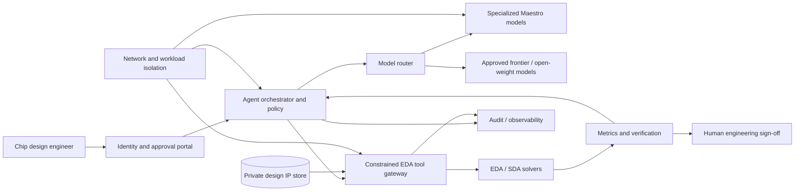

# Cadence Maestro Brings AI Chip-Design Agents On-Premises — The Architecture Behind the Announcement

**Research verified 27 October 2026.** This article explains an announced commercial product and presents an **independent conceptual reference architecture**. No access to Maestro, proprietary EDA software or customer deployment is claimed.

## Executive summary

On **26 October 2026**, Cadence announced **Maestro**, a portfolio of domain-specialized AI models for semiconductor and system design. Maestro is intended to work with Cadence AI Super Agents and its electronic-design-automation (EDA) and system-design-automation (SDA) tools. Cadence describes a feedback loop in which agents propose actions, deterministic tools evaluate engineering results and the results inform model improvement. The company says the full environment can operate in Cadence's cloud, public clouds or customer-controlled **on-premises** infrastructure. [1]

This is interesting beyond chip design. It is a case study in **enterprise agent architectures that combine specialized models, deterministic tools, verified feedback, private intellectual property and flexible deployment**.

Cadence reports initial design-workflow results of **up to 30% higher quality of results** and **up to 5× greater token efficiency** relative to a general-purpose foundation model. These are **vendor-reported, workflow-specific** results, not independently verified across all designs, and 5× token efficiency is **not** a promise of 5× lower total cost. [1]

The first Maestro models are offered to **select early-access customers in Q4 2026**. Do not interpret the announcement as a public model download, a general-availability date or an open-source release. [1]

## What Cadence actually announced

The portfolio combines specialized post-trained language models, decision models and self-improving agent skills. Cadence names **AuraStack, ChipStack, InnoStack and ViraStack** as AI Super Agents that can combine these models with EDA/SDA tools. Its collaboration with NVIDIA includes **Nemotron** models and planned integration with the **OpenShell reference architecture** for agent security. [1]

| Claim | Evidence | Important caveat |
| --- | --- | --- |
| Maestro portfolio announced | Cadence release dated 26 October 2026 [1] | Announcement is not general availability |
| Customer-controlled on-prem option | Cadence release [1] | Hardware requirements and commercial terms not published in the release |
| Up to 30% higher quality | Initial vendor-reported design workflows [1] | Not an independent cross-workload benchmark |
| Up to 5× token efficiency | Initial vendor-reported workflows [1] | Not 5× overall cost reduction |
| NVIDIA Nemotron involved | Cadence/NVIDIA statement [1] | An open-weight component does not make the complete Maestro product open-weight |
| OpenShell security collaboration | Cadence release [1] | Integration details and security certification require confirmation |
| Early access | Select customers, Q4 2026 [1] | Not publicly available to everyone |

Cadence's third-quarter results, also released on **26 October**, describe more than **100 active AI Super Agent customer engagements**, but those engagements are not equivalent to 100 Maestro production deployments. [2]

## Why on-premises matters for semiconductor AI

Chip-design inputs can include RTL, netlists, physical-design constraints, proprietary process information, verification results, foundry-specific assumptions and product roadmaps. An AI agent that can read this data and invoke engineering tools becomes part of the organization's most sensitive intellectual-property workflow.

On-premises deployment can improve control over data residency, network access and integration with internal toolchains. It **does not automatically** deliver sovereignty or security: organizations still need to assess vendor telemetry, update mechanisms, licensing checks, administrator access, data retention and model-artifact provenance.

For architects, the main question is not “cloud or local?” but **which parts of the workflow cross which trust boundaries**.

## How a domain-specialized engineering agent works

A conventional chatbot predicts text. A chip-design agent can be organized around an engineering loop:

1. A human supplies an objective such as “improve timing without exceeding area and power budgets.”
2. An orchestrator selects a model or specialized skill for the task.
3. The agent proposes a constrained design change or tool invocation.
4. An authorized EDA/SDA tool runs a deterministic check or simulation.
5. The system captures measurable outcomes: timing, power, area, rule violations and run duration.
6. A policy engine decides whether the result is eligible for review or further exploration.
7. Human engineers approve changes before integration into protected design branches.

The agent is a **proposal and orchestration layer**. Engineering sign-off remains grounded in validated tools, process rules and accountable reviewers.

## Conceptual architecture for private-cloud deployment

This Mermaid diagram is **not a reverse-engineered Cadence deployment**. It is a proposed architecture inspired by the documented capabilities.



See the standalone [system context diagram](../../../diagrams/2026-10-27-cadence-maestro-onprem-context.svg), [deployment boundary diagram](../../../diagrams/2026-10-27-cadence-maestro-onprem-deployment.svg) and [architecture decision record](../../../architecture/2026-10-27-cadence-maestro-onprem-design-decisions.md).

## Deployment choices: what an architect must compare

| Dimension | Vendor-managed cloud | Public-cloud customer tenancy | Customer-controlled on-prem |
| --- | --- | --- | --- |
| Data control | Contractual and technical vendor controls | Customer IAM/network plus provider controls | Strongest potential local control, if properly designed |
| Model operations | Vendor-led | Shared responsibility | Customer bears most operational responsibility |
| EDA integration | May require private connectivity | Private links / hybrid networking | Close to existing EDA clusters and license servers |
| Hardware procurement | Usually abstracted | Cloud compute and storage billing | GPU/CPU procurement, power, cooling, capacity planning |
| Resilience | Vendor SLAs to verify | Customer-designed multi-zone recovery | Customer-designed HA/DR |
| Sovereignty | Must assess geography and access | Must assess jurisdiction and support access | Must assess vendor support, telemetry and supply chain |

**No GPU sizing is asserted for Maestro**: the release does not specify model sizes, quantization formats, throughput requirements, minimum VRAM or hardware bills of materials. Nemotron participation alone cannot be used to infer these specifications.

## Security design: trust boundaries matter more than labels

**Design identity:** Separate human, orchestrator, model-serving and tool-executor identities. Prefer short-lived, scoped workload credentials; never give a model direct EDA administrator credentials.

**Gate tool execution:** Use an explicit allowlist for tool commands, design repositories and license servers. Distinguish read-only analysis from design-changing operations.

**Isolate compute:** Put inference and tool execution in segmented networks. Use firewall rules and workload policies to limit outbound access and protect foundry IP.

**Protect the feedback loop:** Treat solver outputs and metrics as trusted only after provenance, tool-version and run-configuration checks. An agent should not be able to edit its own acceptance criteria.

**Human sign-off:** Gate merges into protected RTL and physical-design branches. Preserve audit records outside the agent's write scope.

**Verify OpenShell integration:** Cadence references NVIDIA OpenShell collaboration, but the exact enforcement coverage, release status and hardware dependencies for a particular Maestro deployment must be established with the vendor. [1, 3]

## A safe, reproducible educational demonstration

Maestro is not publicly available for a reproducible installation tutorial as of this article's verification date. Instead, demonstrate the **architecture pattern** using open-source EDA tooling without presenting it as a Cadence benchmark.

**Suggested lab:** a small synthetic Verilog design; [Yosys](https://yosyshq.net/yosys/) for synthesis; [OpenROAD](https://openroad.readthedocs.io/en/latest/) for a physical-design workflow where practical; a mock model-planner that proposes bounded parameter changes; a script that parses deterministic tool metrics; and a human approval gate. [4, 5]

A simplified conceptual control loop:

```text
for candidate in approved_candidate_set:
    assert policy.permits(candidate, design_scope)
    run = eda_executor.run(candidate, isolated_workspace=True)
    metrics = verifier.parse_and_validate(run, tool_version, design_hash)
    audit.write(candidate, metrics, decision="awaiting_review")
    if metrics.pass_constraints:
        human_review_queue.submit(candidate, metrics)
# No autonomous merge or production tape-out.
```

**Not tested here:** These lines illustrate orchestration, not a working Python API for Yosys, OpenROAD or Maestro. A real tutorial should pin versions, include fixture RTL and publish a reproducible baseline.

## A credible evaluation scorecard

Before adopting a specialized model, run the same **approved** design tasks across a baseline and candidate workflow. Capture:

- **Quality:** PPA metrics, rule violations, functional correctness and engineering sign-off rate.
- **Efficiency:** model tokens, inference time, tool invocations, solver CPU/GPU time, license consumption and human review time.
- **Reliability:** repeated-run variance, task failures, invalid tool calls and recovery time.
- **Security:** denied tool actions, network violations, credential scope, audit completeness and data-retention behavior.
- **Economics:** total cost per accepted engineering change, including infrastructure, licenses, model serving and review.

A 5× token reduction may be economically valuable, but EDA tool runs and human engineering effort can dominate total cost. Do not equate tokens with dollars.

## Questions to ask Cadence before procurement

1. Which Maestro models and AI Super Agents are actually included in early access?
2. What are the on-prem hardware and accelerator requirements for each model?
3. What data leaves the environment for licensing, telemetry, updates or support?
4. Which parts of OpenShell are enforced today, and which remain planned?
5. What are the model and agent update, rollback and audit mechanisms?
6. Can customers benchmark against their own designs under reproducible conditions?
7. How are model training and post-training rights for proprietary design data defined?
8. What are the exact EDA license implications for autonomous tool invocation?

## Limitations and editorial integrity

This article does **not** claim that Maestro weights are downloadable, that every Nemotron variant is supported, that OpenShell is fully integrated, or that Cadence's reported gains have been independently reproduced. The reference architecture is conceptual. Readers should validate vendor claims in their own engineering environments.

## YouTube production brief

**Recommended title:** NVIDIA + Cadence Just Brought AI Chip-Design Agents On-Prem — Here's the Architecture

**Alternative:** Cadence Maestro Explained: Can AI Agents Design Chips Inside Your Data Center?

**Thumbnail:** `AI CHIP DESIGN` / `ON-PREM!`

**Hook:** “Cadence has introduced specialized AI models that work with chip-design agents, deterministic engineering tools and customer-controlled deployment. The important part isn't another chatbot: it's how AI, verified tool feedback and private design data fit into one architecture.”

**Audience:** Enterprise AI architects, private-cloud and GPU platform teams, semiconductor/EDA engineers, CTOs and technical buyers.

**Search intent:** Cadence Maestro AI models, AI chip design on-prem, NVIDIA Nemotron EDA, OpenShell enterprise agents, sovereign AI semiconductor.

**Supply assessment:** The precise on-prem architecture and security-angle queries produced no dependable quantified YouTube inventory. General semiconductor and AI-agent coverage may be competitive. This is a **niche technical differentiation hypothesis**, not a measured supply gap.

**Urgency:** Medium-high (within 48–72 hours for news); evergreen for the enterprise architecture explainer.

## Primary sources and further reading

1. Cadence, “Cadence Introduces Maestro, a Domain-Specialized AI Model Portfolio to Revolutionize Agentic Chip and System Design,” **26 October 2026**: https://www.cadence.com/en_US/home/company/newsroom/press-releases/pr/2026/cadence-introduces-maestro-a-domain-specialized-ai-model.html
2. Cadence, “Cadence Reports Third Quarter 2026 Financial Results,” **26 October 2026**: https://www.cadence.com/en_US/home/company/newsroom/press-releases/pr-ir/2026/cadence-reports-third-quarter-2026-financial-results.html
3. NVIDIA, “NVIDIA Launches Open Agent Safety Platform to Secure Agents From Testing to Deployment,” **28 September 2026**: https://www.globenewswire.com/news-release/2026/09/28/3369606/0/en/nvidia-launches-open-agent-safety-platform-to-secure-agents-from-testing-to-deployment.html
4. OpenROAD documentation: https://openroad.readthedocs.io/en/latest/
5. Yosys project documentation: https://yosyshq.net/yosys/

**Editorial note:** The comparative performance figures are Cadence's initial claims, not independently validated numbers. The architecture and lab are independent recommendations, not descriptions of a tested Maestro installation.
