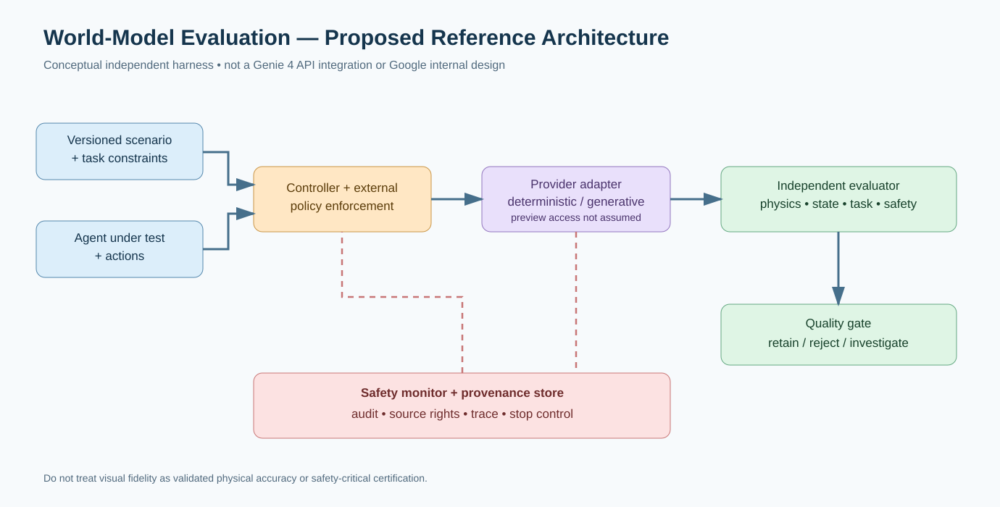
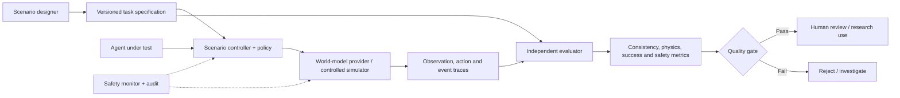

# Google Genie 4: Can AI World Models Become Reliable Training Environments for Agents and Robots?

> **Evidence date: 28 October 2026.** This is a technical analysis of an announced **limited research preview**, not a personal hands-on evaluation of Genie 4 or a claim of public API access.

## Executive summary

On **27 October 2026**, **Google DeepMind** introduced **Genie 4**, a new real-time interactive world model. DeepMind says the system supports photorealistic environments, **native audio and dialogue**, text-guided changes during exploration, and simulation of people and physical interactions. Its accompanying research post describes **Gemini 3.8 Flash** as a guidance agent that observes generated frames, plans multi-step actions and adjusts the simulated environment as goals evolve. It also describes experimental integration with **Gemini 4 Argon** and robotics scenarios.

This is a compelling breakthrough for **interactive prototyping**. It is **not yet evidence that generated environments reproduce real-world dynamics reliably enough to train safety-critical robots**. DeepMind itself warns of drifting visual details, object permanence, spatial accuracy, complex physics, long-session consistency and real-time audio accuracy.

**The differentiated question:** How should AI engineers evaluate a generated world before trusting it for robot training, agent benchmarks or enterprise simulations?

Source: [Google DeepMind announcement, 27 Oct 2026](https://deepmind.google/blog/genie-4-a-new-generation-of-world-simulation/).

## What changed compared with earlier world-model demonstrations?

DeepMind's October 27 post emphasizes four areas:

1. **Real-time natural-language steering:** users can modify conditions and introduce elements while a simulation is running; Gemini helps adapt changes to the existing scene.
2. **Human movement and physical interactions:** more natural-looking motion and examples involving collisions and aerodynamics, according to the vendor.
3. **Native multimodal sound:** ambient sound and interactive dialogue are generated as part of the simulated world.
4. **Multi-step simulation guided by Gemini:** Gemini 3.8 Flash observes frames, decomposes goals, checks progress and adjusts the plan. DeepMind also demonstrates a research scenario involving Gemini 4 Argon and Genie 4.

These are **vendor-reported demonstrations**, not a public reproducible benchmark. Google does not establish in the announcement that the system is physically accurate across arbitrary robotics tasks.

## Availability: do not confuse preview with a general release

DeepMind states that Genie 4 is **rolling out as a research preview to trusted testers**. Broader access is **planned** for Google AI Ultra subscribers via Project Genie and selected early-access Gemini API / Google AI Studio partners. The announcement provides a **waitlist**, not a generally available model download or a guaranteed self-hosted option.

**Do not publish:** “Run Genie 4 locally,” “Genie 4 API is open to everyone,” “Genie 4 weights released,” or “We benchmarked Genie 4” unless subsequent primary evidence supports those claims.

## World simulation versus physics simulation

A video that *looks* physically plausible is not necessarily a simulator that produces correct forces, contact mechanics, collision outcomes or control-system dynamics. World models can generate convincing observations while violating hidden physical constraints. This distinction matters when an autonomous policy learns from synthetic episodes and then acts in a real environment.

Consider a robot arm moving a fragile object. A visually plausible generated clip might omit subtle contact forces or slippage. A policy trained on that clip could fail when deployed on actual hardware. A responsible evaluation therefore separates:

- **Perceptual quality:** visual and audio fidelity.
- **Temporal consistency:** whether objects and locations remain stable over time.
- **Action responsiveness:** whether the world reacts consistently to repeated controls.
- **Physical validity:** whether trajectories and collisions agree with measured references.
- **Task success:** whether an independent evaluator can verify the objective.
- **Safety:** whether unsafe states are detectable and blocked.
- **Reproducibility:** whether prompts, seeds, versions and traces can be compared.

High perceptual quality alone does not imply good sim-to-real transfer.

## Proposed evaluation architecture





**This is a proposed vendor-neutral evaluation harness**, not DeepMind's published internal architecture or an implemented Genie 4 integration. The [design-decision record](../../../architecture/2026-10-28-google-genie-4-world-model-evaluation-design-decisions.md) explains controls, alternatives and risks.

### Architecture components

**Scenario specification.** Define the initial state, action space, permitted interventions, expected physical or logical constraints, stop conditions and success criteria. Version all scenario definitions.

**World provider.** Treat a generative world model as a pluggable **candidate provider**. Until Genie 4 access and API details are confirmed, evaluate the harness using a deterministic local simulator or recorded, rights-cleared observations. Do not invent a Genie 4 API contract.

**Controller.** Mediates agent actions and natural-language scene changes. It should enforce rate limits, reject prohibited operations, and record every intervention.

**Independent evaluator.** Compares observations against task requirements, ground-truth measurements or a trusted physics baseline. It must not simply ask the same model to grade itself.

**Quality gate.** Prevents simulation episodes with drift, implausible outcomes or unsafe content from being promoted into training or demonstrations.

**Safety and provenance.** Preserve versioned prompts, action logs, evaluation results and source permissions. DeepMind says Genie 4-generated video and audio will include **SynthID** watermarking; do not remove provenance markers.

## Reproducible demonstration today—without claiming Genie 4 access

The practical video can show a **vendor-neutral agent evaluation lab** and then explain where Genie 4 would fit if access becomes available.

### Prerequisites

Use Python, a deterministic local environment (for example, an educational grid world or an approved physics simulator), Git for versioning, and a simple JSONL event log. The environment must be synthetic and non-safety-critical.

### Step 1: Define a measurable task

Example: a simulated warehouse robot must move from a start cell to a destination while avoiding blocked cells and staying within a maximum step count. Record the grid dimensions, obstacles, initial position, target and time limit. Use the same scenario across all candidate simulators.

### Step 2: Create an independent test oracle

A deterministic baseline computes valid moves and the expected end state. An evaluation pass checks:

- no illegal move through a wall;
- no disappearing/reappearing obstacles;
- target reached within the time budget;
- no unauthorized state changes;
- complete action and observation log.

### Step 3: Run repeated trials

Run multiple seeds or scenario variants. Report the **number of trials**, **success count**, **collision count**, **state inconsistency count** and **mean steps**. Do not claim these are Genie 4 results unless Genie 4 was actually used and the run artifacts are published.

### Step 4: Compare simulation modes

Compare a deterministic baseline against a hypothetical generative-world provider through an interface such as:

```python
from typing import Protocol

class WorldProvider(Protocol):
    def reset(self, scenario: dict) -> dict: ...
    def step(self, action: dict) -> dict: ...

def evaluate_episode(world: WorldProvider, scenario: dict, policy, max_steps=100):
    observation = world.reset(scenario)
    trace = []
    for index in range(max_steps):
        action = policy(observation)
        observation = world.step(action)
        trace.append({"step": index, "action": action, "observation": observation})
        if observation.get("terminated", False):
            break
    return trace
```

This is an **interface sketch**. A production implementation would validate types, enforce timeouts, sanitize logs and apply a separate deterministic judge. It is **not a Genie 4 SDK example**.

### Step 5: Introduce controlled perturbations

Change one condition at a time: lighting, obstacle location, camera position or an agent instruction. Measure whether the same task logic still holds. If the world changes object identity, collision behavior or hidden state inconsistently, mark the episode invalid.

### Step 6: Report failure modes transparently

Include examples of successful and unsuccessful episodes, not only polished clips. A responsible result states which claims are backed by measurements, which are visual impressions and which remain hypotheses.

## A practical scorecard for generative worlds

| Evaluation axis | Example test | Failure signal |
|---|---|---|
| Object permanence | Navigate away and return | Object vanishes or changes identity |
| Spatial continuity | Revisit a mapped route | Geometry shifts unexpectedly |
| Action causality | Repeat same action from same state | Inconsistent or unexplained response |
| Contact dynamics | Compare with instrumented reference | Implausible collision or slip |
| Multi-step planning | Reach goal after intermediate actions | Goal state cannot be verified |
| Audio fidelity | Compare event timing to sounds | Missing or delayed causal sound |
| Safety | Inject disallowed scenario requests | Unsafe output or bypass |
| Provenance | Inspect generated-asset metadata | Missing trace or attribution |
| Operational readiness | Test timeout, retries, cost and limits | Non-reproducible sessions |

For robotics, supplement these tests with a validated physics simulator and real-world supervised trials. Never use a generative video alone to certify a physical robot for safe operation.

## Where this could create value

**Robotics and industrial training:** generate varied scenes for early-stage perception experiments, but validate physics before control-policy training.

**Games and interactive media:** rapid previsualization, narrative prototyping and style exploration; export or reconstruction into conventional game engines may still be needed.

**Education:** immersive historical, scientific and vocational scenarios, with fact checking and accessibility controls.

**Enterprise testing:** synthetic user journeys and rare-event scenario ideation; privacy, reproducibility and fidelity must be independently evaluated.

**Technical consulting:** world-model evaluation frameworks, model-risk assessment and synthetic-data quality gates. These are potential service offerings, not measured market demand.

## Limitations and open questions

DeepMind explicitly lists visual drift, object permanence, complex physical interactions, spatial accuracy, real-time audio fidelity, text rendering and long-term consistency as research challenges. The announcement does **not** provide a public benchmark proving robust sim-to-real transfer, general API access, model weights, pricing or supported production SLAs.

It would be misleading to call the model a replacement for Gazebo, Isaac Sim or a certified industrial digital twin. A hybrid approach may eventually pair generated observations with a trusted physics or task-state engine, but that is an architectural proposal, not a verified Genie 4 feature.

## YouTube production plan

**Video title:** Google Genie 4 Looks Real — But Can AI Agents Actually Train Inside It?  
**Thumbnail:** `GENIE 4` / `REAL OR SIMULATED?`  
**Opening hook:** “Google's new world model can generate interactive environments with sound, dialogue and changing physics. But would you trust a robot trained in a world where objects might disappear when you turn around?”

**Structure:** (1) 60-second verified announcement; (2) demo clips clearly credited to DeepMind; (3) explanation of Gemini guidance versus generative rendering; (4) local deterministic agent-evaluation lab; (5) comparison of visual fidelity and physical correctness; (6) preview availability and limitations.

**Audience:** robotics students, ML engineers, game developers, simulation architects and educators.  
**Priority:** High within 24–48 hours of the October 27 release.  
**Supply hypothesis:** General Genie 4 launch videos will likely proliferate quickly; the **sim-to-real evaluation and test-harness angle** is a narrower, potentially less saturated technical niche. No reliable creator-supply or keyword-search-volume measurements were established, so no numerical demand/supply claims are made.

## Sources and further reading (checked 28 October 2026)

1. Google DeepMind, **“Genie 4: A new generation of world simulation”**, 27 Oct 2026 — https://deepmind.google/blog/genie-4-a-new-generation-of-world-simulation/
2. Google DeepMind, **“Genie 3: A new frontier for world models”** (background, Aug 2025) — https://deepmind.google/discover/blog/genie-3-a-new-frontier-for-world-models/
3. Google DeepMind, **Genie 4 research preview and waitlist** (linked from the official announcement) — https://deepmind.google/blog/genie-4-a-new-generation-of-world-simulation/
4. Google DeepMind, **Gemini Robotics overview** — https://deepmind.google/models/gemini-robotics/
5. Farama Foundation, **Gymnasium documentation** (example local benchmark tooling, independent of Genie 4) — https://gymnasium.farama.org/
6. Google DeepMind, **SynthID overview** — https://deepmind.google/technologies/synthid/

*Editorial disclosure: The author did not access Genie 4. Any lab exercise here uses a substitute deterministic simulator and must not be presented as a Genie 4 benchmark.*
