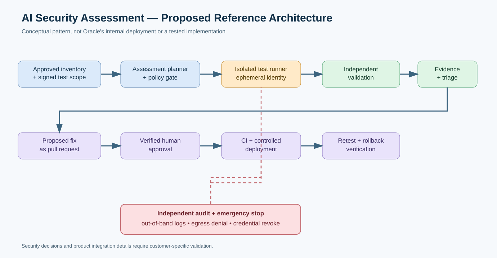
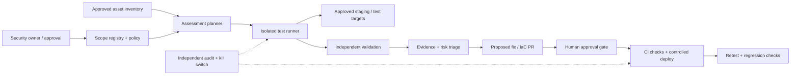

# Oracle + OpenAI AI Security Mesh: The Enterprise Architecture Behind AI-Powered Vulnerability Remediation

> **Evidence date: 28 October 2026.** This is an independent technical analysis and a **proposed reference design**, not a hands-on review or verified production deployment of Oracle AI Security Mesh.

## Executive summary

On **27 October 2026**, Oracle announced **Oracle AI Security Mesh**, a managed offering combining **OpenAI frontier cybersecurity models** with Oracle's security testing and enterprise context. Oracle describes a workflow that maps approved systems, investigates plausible weaknesses, independently reproduces findings, prioritizes impact, proposes fixes, requires customer approval for remediation, and retests. Oracle also highlighted **OCI Identity Assurance** and **OCI Zero Trust Packet Routing (ZPR)** as complementary controls—not necessarily mandatory components of every Security Mesh installation.

The interesting story is **not** “AI fixes every vulnerability automatically.” It is the architecture required to make autonomous security investigation **authorized, bounded, auditable and reversible**. Oracle's announcement is a concrete new reference point for a broader shift from alert-only scanning toward evidence-backed agent workflows.

**Primary evidence:** [Oracle announcement (27 Oct)](https://www.oracle.com/fr/news/announcement/ai-world-oracle-advances-enterprise-security-for-the-ai-era-2026-10-27/), [Oracle product page](https://www.oracle.com/artificial-intelligence/security-mesh/), [Oracle technical/product blog (27 Oct)](https://blogs.oracle.com/ai-and-datascience/introducing-oracle-ai-security-mesh).

## What was actually announced—and what was not

Oracle says Security Mesh can assess applications and infrastructure across **OCI, other clouds and on-premises environments**. A customer defines the authorized scope. Specialized agents examine possible attack paths; a separate agent verifies whether a finding reproduces; a customer approves remediation before changes are applied. Oracle describes agent-specific identities, task scopes, just-in-time privileges and independent monitoring.

**Important distinctions:**
- **Announced product ≠ universally available API or self-hostable software.** Oracle's product page directs prospective customers to contact Oracle; publicly documented onboarding, pricing, SLAs and exact API contracts were not established in the sources reviewed.
- **AI model ≠ enforcement boundary.** Access-control policy, credentials, sandboxing, change approval and logging must be enforced outside model-generated text.
- **ZPR is an OCI network control, not a replacement for IAM.** OCI documentation says network traffic must satisfy routes, NSGs/security lists **and** ZPR rules when protected attributes apply.
- **Independent validation is a product claim.** We have not run a blind third-party evaluation of its precision, recall, false-positive rate or operational safety.
- **No claim of unattended production patching.** Oracle explicitly states that customers approve remediation changes.

## Why the architecture matters

Traditional vulnerability management often ends at a list of findings. A more complete defensive workflow links **asset context → hypothesis → authorized test → independent confirmation → change proposal → approval → controlled rollout → regression verification**. Each transition creates a trust boundary: asset inventories can be incomplete; generated hypotheses can be wrong; a reproducer can be disruptive; code changes can break production; and agents may access secrets or cross tenant boundaries if not constrained.

The central design principle is to **separate what an agent may suggest from what infrastructure will permit**. A policy engine should reject any out-of-scope target or unsafe operation even if the agent attempts it. A change-management system should independently verify the identity of the approving human. A separate logging plane should preserve evidence.

## Proposed enterprise reference architecture





**Legend:** This diagram is an **independent conceptual pattern**, inspired by the vendor's stated workflow. It is **not** a disclosure of Oracle's internal implementation. The separate [design-decision record](../../../architecture/2026-10-28-oracle-openai-security-mesh-design-decisions.md) explains assumptions and alternatives.

### Trust boundaries

1. **Assessment scope:** signed, time-limited authorization defining domains, hosts, accounts, regions, environments, allowed techniques and exclusion lists.
2. **Agent execution:** ephemeral identity and credentials; restricted network egress; resource quotas; no broad production write permissions.
3. **Evidence plane:** append-only or externally controlled logs; sensitive output redacted; retention and access controls.
4. **Change plane:** generated patches become reviewable pull requests, not direct production mutations.
5. **Production deployment:** independently enforced approvals, CI tests, progressive rollout and rollback.

## Practical defensive demonstration: build the approval workflow without Oracle access

The following is a **vendor-neutral lab** demonstrating the governance ideas, not an Oracle Security Mesh installation.

### Lab prerequisites

Use a dedicated, owned staging application with synthetic data, a Git repository, CI, a test namespace or isolated VM, a security scanner that you are authorized to operate, and an issue tracker. Never point automated security agents at third-party systems without written authorization.

### Step 1 — Declare the permitted scope

Store a reviewable `assessment-scope.yaml`:

```yaml
assessment_id: training-lab-001
environment: staging
owner: platform-security
targets:
  - name: demo-api
    url: https://staging.example.invalid
allowed_actions:
  - passive_inventory
  - authenticated_functional_checks
  - approved_low_impact_validation
prohibited_actions:
  - destructive_testing
  - production_changes
  - credential_export
change_policy:
  remediation_requires_human_approval: true
  deploy_requires_ci_pass: true
  rollback_plan_required: true
expires_at: "2026-11-15T23:59:00Z"
```

**Note:** This YAML is a *proposed local governance format*, not an Oracle product API. `.invalid` is an intentionally non-routable example domain.

### Step 2 — Prove tenant isolation with normal application tests

For a multi-tenant demo API, create synthetic tenant A and B records. With an authenticated tenant A test client, request A's record (expect success) and attempt to request B's record (expect a denied response). Capture the test name, authorization context, expected outcome, actual outcome and a sanitized trace. This is an application authorization regression test, **not** an instruction to exploit a live service.

### Step 3 — Validate findings independently

Do not accept a model-generated finding as confirmed. Reproduce with a separate deterministic test runner and require matching evidence. Record the application's commit SHA and test-environment configuration so results can be replayed.

### Step 4 — Propose changes via a pull request

An assistant may suggest an ownership check, policy update or network restriction. The CI pipeline should enforce unit tests, cross-tenant regression tests, dependency scanning, secret scanning and infrastructure policy checks. Security and application owners approve the PR; the deployment identity should be distinct from the agent identity.

### Step 5 — Retest and roll back

After staging deployment, run the original regression plus normal user flows. Deploy progressively if production rollout is approved; monitor error rate, latency and authorization-denial anomalies. If thresholds breach, roll back using the preapproved plan.

## OCI Zero Trust Packet Routing: what to verify

OCI documentation states that ZPR uses security attributes and intent-based policies; a packet must pass routing, NSGs/security lists and ZPR. **Enabling ZPR alone does not automatically protect every resource:** enforcement applies to resources with relevant security attributes. Before applying attributes to an existing production service, validate the policies in a test environment; otherwise you may block legitimate access. See [Oracle ZPR overview](https://docs.oracle.com/en-us/iaas/Content/zero-trust-packet-routing/overview.htm) and [ZPR enablement notes](https://docs.oracle.com/en-us/iaas/Content/zero-trust-packet-routing/enable-zpr.htm).

For hybrid environments, use cloud-native controls where available and equivalent independent network policy or firewall controls outside OCI. **Do not imply OCI ZPR policies directly enforce traffic inside AWS, Azure, or a private OpenStack network.**

## Evaluation scorecard before procurement

| Dimension | Acceptance question | Evidence to request |
|---|---|---|
| Coverage | Which apps, APIs, clouds and on-prem assets are supported? | Scope matrix, connector list |
| Authorization | How are targets and methods explicitly approved? | Signed scope, deny-by-default tests |
| Safety | Can an agent be stopped independently? | Kill-switch demo, network-denial logs |
| Precision | Are findings independently reproducible? | Blind test corpus, false-positive rate |
| Data handling | Where are prompts, source code and evidence retained? | Residency, retention and deletion terms |
| Change control | Can remediation bypass human approval? | Approval audit and negative tests |
| Reliability | What happens if an assessment stalls? | Timeouts, rate limits, incident runbooks |
| Cost | What is billed per assessment or environment? | Current commercial quote |
| Outcome | Does the fix remove the issue without regressions? | Retest + functional CI evidence |

A meaningful proof of value uses a small **known-defect staging corpus** plus normal business flows, measures coverage and false positives, and logs every action. No performance or cost figures should be claimed without a reproducible benchmark or signed vendor quote.

## Threat model and operational trade-offs

**Threats:** scope expansion, prompt injection via repository or web content, credential theft, lateral movement, noisy/disruptive tests, false findings, unsafe generated patches, secret leakage in logs, approval spoofing and model-output overtrust.

**Controls:** external policy enforcement, per-task identity, short-lived credentials, egress allowlists, isolated execution, independent audit, separation of duties, artifact signing, CI gates, staging-first rollout and a rehearsed stop procedure.

**Trade-offs:** tighter isolation increases cost and can reduce assessment fidelity; more approval gates slow remediation; broader system context improves detection but increases data sensitivity. These trade-offs should be made explicitly, not hidden behind a model capability claim.

## YouTube publishing opportunity

- **Recommended title:** Oracle + OpenAI Just Launched AI Security Mesh — Can AI Agents Fix Your Cloud Security?
- **Thumbnail:** `AI SECURITY MESH` / `SAFE OR RISKY?`
- **Opening hook:** “Oracle says its new OpenAI-powered security system can investigate vulnerabilities and propose fixes across cloud and on-prem systems. But the most important question is what stops the security agent itself from becoming a risk.”
- **Audience:** SOC leads, cloud/platform architects, DevSecOps teams, CISO offices, regulated SaaS builders.
- **Suggested video:** 8–12 minutes; 90-second news summary, architecture walkthrough, five-minute synthetic tenant-isolation/PR approval lab, vendor-evaluation checklist.
- **Urgency:** High for the first 24–48 hours after the October 27 announcement.
- **Differentiation:** Most announcement coverage describes the product; this video teaches the **authorization, verification and approval architecture**.
- **Monetization fit:** enterprise architecture workshops, DevSecOps training, security review templates and cloud governance consulting. These are possible business models, not revenue forecasts.
- **Supply caveat:** No verified YouTube keyword volume, video count or creator-supply statistics are available from this research; “lower competition” is a qualitative hypothesis for the specialist angle.

## What to watch next

Look for official public onboarding/API documentation, pricing, geographic availability, supported scanners and connectors, deployment architecture, independent security evaluations and customer-reported outcomes. Update this article when such evidence appears.

## Primary references (checked 28 October 2026)

1. Oracle, **“Oracle Advances Enterprise Security for the AI Era”**, 27 Oct 2026 — https://www.oracle.com/fr/news/announcement/ai-world-oracle-advances-enterprise-security-for-the-ai-era-2026-10-27/
2. Oracle, **AI Security Mesh product page** — https://www.oracle.com/artificial-intelligence/security-mesh/
3. Oracle AI & Data Science Blog, **“Introducing Oracle AI Security Mesh”**, 27 Oct 2026 — https://blogs.oracle.com/ai-and-datascience/introducing-oracle-ai-security-mesh
4. Oracle, **“Oracle Reinvents Enterprise Computing for the AI Era with OpenAI”**, 27 Oct 2026 — https://www.oracle.com/asean/news/announcement/ai-world-oracle-reinvents-enterprise-computing-for-the-ai-era-with-openai-2026-10-27/
5. Oracle documentation, **Overview of Zero Trust Packet Routing** — https://docs.oracle.com/en-us/iaas/Content/zero-trust-packet-routing/overview.htm
6. Oracle documentation, **Enabling Zero Trust Packet Routing** — https://docs.oracle.com/en-us/iaas/Content/zero-trust-packet-routing/enable-zpr.htm
7. OWASP, **State of Agentic AI Security and Governance 2.01**, 1 Jun 2026 — https://genai.owasp.org/resource/state-of-agentic-ai-security-and-governance/

*Editorial disclosure: No hands-on access to the announced managed service was used; proposed architectures and lab configurations are illustrative.*
