# AWS Warns Brotli Flaw Reaches Beyond Node.js: How to Patch Lambda, Containers, and CI

**Published:** 29 October 2026 | **Primary sources checked:** 29 October 2026 | **Security advisory; validate service status immediately before acting.**

> **Executive summary:** A **21 October 2026** Node.js security release addressed **CVE-2026-111497**, a high-severity native Brotli decoder out-of-bounds write. A **new AWS advisory dated 28 October, 15:00 PDT** materially expands the operational story: the issue is not confined to Node.js, and AWS lists affected **Node.js and .NET Lambda runtimes**, customer-managed containers, build images, and other services with different patch timelines. **The AWS Lambda managed service itself is not compromised by this advisory; some language runtimes it supplies contain the vulnerable library.** A one-size-fits-all "upgrade Node and you're done" message is incomplete. [1][2]

## Why this is new, not a recycled Node.js headline

The Node.js project publicly documented the decoder flaw and released fixed versions on **21 October**. The **28 October AWS bulletin** adds specific cloud-service rollout phases, .NET runtime exposure, CodeBuild image guidance, App Runner redeployment requirements, and a mitigation option for inbound Brotli-encoded requests. These newly published operational details are the reason for this article. [1][2]

### What the vulnerability does

Brotli is a compression format. In the affected native decoder, malformed compressed input can cause an internal buffer to be written out of bounds during decompression. If an application processes attacker-supplied Brotli data using an affected library, the consequences may include process crash, memory disclosure, or code execution. **Actual exploitability depends on whether the vulnerable decoding path is reachable**, not merely on whether a Brotli package name exists in a dependency list. Do not reproduce malformed payloads against live services. [2]

The Node.js project's affected supported release lines are **22.x, 24.x, and 26.x**, with security releases **22.23.4, 24.22.1, and 26.12.1**. AWS warns that Brotli decoding is used beyond Node.js, and some other vendor fixes were not yet available at advisory publication. [1][2]

## AWS-specific service matrix — as reported on 28 October

| Workload | AWS advisory status | Operator action |
|---|---|---|
| Lambda managed service | Managed service **not affected** | Distinguish service infrastructure from language runtimes |
| Lambda Node.js 22/24/26 ZIP runtimes | Affected runtime; phased rollout | Confirm region/phase, update code or configuration after Phase 1, verify INIT_START runtime version |
| Lambda Node.js container base images | Updated | Rebuild and redeploy images from refreshed base images |
| Lambda .NET 8/9 (container only)/10 | Affected runtime; phased patches | Track AWS's .NET-specific schedule and patched identifiers |
| Lambda Python/Ruby/OS-only provided.al2023 | Runtime doesn't include Brotli by default | Audit any Brotli libraries bundled in function packages or layers |
| App Runner managed Node.js | Updated managed runtime deployed 26 October | Redeploy if service has not deployed since then; update explicit old pins first |
| CodeBuild curated images | Updates in progress, target 30 October | Update pinned image references, rebuild custom images, migrate old Node versions |
| Elastic Beanstalk Node.js | Platform 6.11.12 released 22 October | Move to patched platform; confirm actual instance runtime |
| Amplify SSR on supported Node | Managed rollout | Monitor AWS notice; migrate unsupported Node versions |
| EC2 / ECS / EKS custom Node workloads | Customer-managed | Patch runtime/library, rebuild, redeploy, verify image digest and process version |

**Do not assume that a target date means every region has completed rollout.** AWS says ZIP runtime patches roll out in phases and may vary by region. For **Node.js 24**, AWS explicitly notes a regression in upstream **24.22.1** and says it is applying targeted updates to the current stable runtime rather than simply switching to that version. Follow the service-specific AWS guidance. [1]

## Recommended response workflow

The workflow below is a **proposed defensive playbook**, not a description of AWS's internal patch pipeline.

```mermaid
flowchart LR
  A["Inventory Lambda, ECS, EKS, EC2, CI"] --> B["Identify Brotli decoding paths"]
  B --> C["Classify managed vs customer-managed"]
  C --> D["Read current AWS/vendor patch status"]
  D --> E["Patch or rebuild in staging"]
  E --> F["Regression and security tests"]
  F --> G["Canary rollout + rollback gate"]
  G --> H["Verify runtime and image digest"]
  H --> I["Record evidence + monitor"]
```



**Architecture diagram:** [Cloud runtime remediation flow](../../../diagrams/2026-10-29-aws-brotli-lambda-patching-context.svg)  
**Architecture decisions:** [Patch and verification ADR](../../../architecture/2026-10-29-aws-brotli-lambda-patching-design-decisions.md)

### 1. Inventory what actually runs

For **customer-managed Node.js**, record:

```bash
node --version
node -p "process.versions.brotli"
# Debian/Ubuntu native package (if installed):
dpkg-query -W libbrotli1 2>/dev/null || true
# RHEL/Amazon Linux family (if installed):
rpm -q brotli 2>/dev/null || true
```

The presence or version of `process.versions.brotli` is **inventory evidence, not proof that the whole environment is patched**. Native libraries may be bundled independently in dependencies, Lambda layers, application archives, and containers. Record SBOMs and build image digests. Do not treat a clean `npm audit` result as sufficient for native runtime components.

For Lambda, obtain runtime metadata for an **authorized function**:

```bash
aws lambda get-function-configuration \
  --function-name YOUR_FUNCTION_NAME \
  --region YOUR_REGION \
  --query '{Runtime:Runtime,PackageType:PackageType,LastModified:LastModified,RevisionId:RevisionId}'
```

This command reads configuration only; it does **not** determine the exact patched runtime build for every execution environment.

### 2. Apply the right patch method

**Lambda ZIP functions:** AWS says that after **Phase 1** reaches a region, a real code or configuration change can cause a new patched runtime to be selected. A zero-change update is insufficient. AWS publishes a script that changes a dedicated environment variable while preserving existing variables. Review its effect on your deployment process and avoid writing secrets into shell history. Phase 2 automatically updates functions configured for Auto runtime updates according to the service schedule. [1]

**Lambda containers:** Pull the updated AWS base image, rebuild your image, scan it, push an immutable digest, and redeploy the function. **Merely restarting a container built from an older image does not rebuild its runtime.**

**App Runner:** AWS says the updated managed Node runtime was deployed on **26 October**. Services not redeployed since then should be redeployed once; if an older runtime is explicitly pinned, change the pin first. [1]

**ECS/EKS/EC2 and custom builds:** Update the runtime to a fixed release or a vendor-backported fix, update system Brotli packages where applicable, rebuild artifacts and container layers, then perform a rolling deployment. Patch the application image and the CI builder image; otherwise the pipeline may reintroduce a vulnerable dependency.

**CodeBuild:** AWS targets **30 October** for updated curated images. Update pinned versions or digests, rebuild custom builder images, and inspect any buildspec that still selects Node.js 18 or 20. [1]

### 3. Verify with evidence, not only a version string

AWS identifies the **Lambda INIT_START log line** as the authoritative runtime patch version indicator for managed runtimes. At advisory publication it lists **`nodejs:22.mainline.v157` or higher** for Node.js 22 and **`nodejs:24.mainline.v114` or higher** for Node.js 24. AWS specifically cautions that **`process.version` does not reflect the Node.js 24 targeted runtime update**. Do not infer an unlisted threshold for Node.js 26 or .NET. [1]

A safe post-deployment checklist:

1. Confirm the updated artifact digest or AWS runtime version in the target **region**.
2. Run ordinary functional and regression tests; do not feed malicious compressed payloads into production.
3. Verify the same checks in each region and alias/traffic-shift configuration.
4. Monitor 5xx errors, decompression failures, cold starts, and latency.
5. Keep a rollback plan—but **never roll back to an image known to contain the vulnerable decoder** without compensating controls and risk approval.

### 4. If you cannot patch immediately

AWS suggests a temporary **AWS WAF** rule that detects inbound requests with `Content-Encoding: br`, initially in **Count** mode and then **Block** after traffic review. This only covers the inbound path inspected by WAF; it does **not** protect applications that decompress Brotli from upstream HTTP responses, queues, files, or other uninspected sources. Blocking legitimate compressed uploads may break clients. A WAF rule is **not a replacement for patching**. [1]

Do not mistake `Accept-Encoding: br` (a client asking for a Brotli response) for `Content-Encoding: br` (the body being Brotli encoded). Test with representative benign traffic, not an exploit.

## Architecture decisions and trade-offs

The companion ADR records seven decisions: dependency/runtime inventory, per-service patch strategy, immutable rebuilds, phased rollout, independent verification, temporary WAF mitigation, and patch provenance. The key trade-off is speed versus regression risk: emergency changes need short feedback cycles but must preserve evidence and a safe rollback route.

## Common mistakes

- Calling the AWS Lambda **managed service** vulnerable when the bulletin distinguishes the service from some **language runtimes**.
- Upgrading only `package-lock.json` while leaving the underlying native runtime unchanged.
- Reusing an old Docker image tag without forcing a rebuild and verifying its digest.
- Assuming all AWS regions receive ZIP runtime patches simultaneously.
- Treating `node --version` as definitive evidence for AWS's targeted Node.js 24 runtime patch.
- Ignoring .NET, native Brotli packages, Lambda layers, CI images, and application dependencies.
- Applying a blocking WAF rule without measuring legitimate Brotli uploads.

## Limitations

This is not a live AWS account audit. Advisory rollout information may change hourly. We did not run an exploit, scan a customer's cloud environment, or independently test a patched AWS runtime. Confirm the current AWS bulletin, the Node.js release advisory, and your service's deployment state before remediation. No claim is made that every application using Brotli is remotely exploitable.

## YouTube production brief

**Recommended title:** **AWS Issues New Brotli RCE Warning — Patch Lambda, Docker & Node.js the RIGHT Way**  
**Thumbnail:** `AWS LAMBDA ALERT` / `BROTLl RCE`  
**Opening hook:** "You may have patched Node.js last week. But AWS just published new guidance showing why your Lambda runtime, .NET functions, container images, or build pipeline may still need attention."  
**Audience:** AWS platform teams, DevOps/SRE, serverless developers, DevSecOps engineers, application owners.  
**Demo:** Safe inventory, service-by-service patch planning, canary rollout, INIT_START verification, and a WAF Count-mode explanation.  
**Urgency:** Immediate; service patch phases are underway 28–31 October.  
**Competition caveat:** The **new AWS cross-runtime remediation angle** is more specific than existing general Node.js CVE coverage. No verified YouTube competition counts or search volumes are available.

## References

1. AWS Security Bulletin **2026-155-AWS**, **CVE-2026-111497: Native Brotli Decoder Remote Code Execution and Memory Disclosure**, published 28 October 2026 15:00 PDT: https://aws.amazon.com/security/security-bulletins/2026-155-aws/
2. Node.js Project, **Wednesday, October 21, 2026 Security Releases**, 21 October 2026: https://nodejs.org/en/blog/vulnerability/october-2026-security-releases
3. CVE record **CVE-2026-111497**: https://www.cve.org/CVERecord?id=CVE-2026-111497
4. AWS Lambda runtime updates: https://docs.aws.amazon.com/lambda/latest/dg/runtimes-update.html
5. AWS Lambda container images: https://docs.aws.amazon.com/lambda/latest/dg/images-create.html
6. AWS WAF rule statements: https://docs.aws.amazon.com/waf/latest/developerguide/waf-rule-statement-type.html
7. AWS App Runner deployment guide: https://docs.aws.amazon.com/apprunner/latest/dg/manage-deploy.html

*This article is a defensive operational guide. Patch status, region rollout, and affected dependencies must be rechecked before publishing or implementing changes.*
