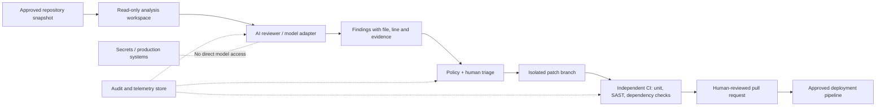

# Gemini 4 Carbon's Cybersecurity Leap: How to Evaluate AI Vulnerability Detection and Patching Safely

**Published:** 29 October 2026 | **Evidence checked:** 29 October 2026 | **Status:** Independent technical analysis; not a hands-on evaluation of Gemini 4 Carbon.

> **Executive summary:** On **28 October 2026**, Google announced Gemini 4 Carbon, emphasizing long-horizon coding and cybersecurity tasks. Google reports **88.2% SEC-bench Pro**, **54.8% ExploitGym**, and **71.0% CWE-bench**, alongside an **Artificial Analysis Intelligence Index v5.0 score of 59**. These are different tests, not interchangeable measures of real-world security. Carbon is initially restricted to selected cybersecurity defenders; a general-access API or local model download should **not** be assumed. This guide explains how to assess such claims and proposes a safe, auditable evaluation pipeline for enterprise defenders. [1][2]

## What changed on 28 October?

Google positions Carbon as the successor to Gemini 4 Argon, announced roughly two weeks earlier. Its launch emphasizes vulnerability discovery, validating risk, generating patches, resisting prompt injection, and sustaining engineering work over long periods. Google reports the following results; attribution matters:

| Measure | Announced result | What it measures | Important qualification |
|---|---:|---|---|
| Artificial Analysis Intelligence Index v5.0 | 59, ranked #1 at announcement | General model intelligence aggregate | Index methodology and leaderboard can change; not a security certification |
| SEC-bench Pro | 88.2% | Finding software vulnerabilities in benchmark tasks | Does not prove that every finding in a real repository is correct |
| ExploitGym | 54.8% | Benchmark-based exploit validation capability | **Dual-use** metric, not a recommendation to exploit real systems |
| CWE-bench | 71.0% | Producing patches in benchmark tasks | A passing benchmark is not production change approval |
| Internal secure-code generation | More than 2x success rate versus Argon | Google's internal evaluation | Vendor-reported, not an independent field study |
| Internal unsupported claims | Approximately halved versus Argon | Google's internal evaluation | Depends on test design and prompt distribution |

**Independent leaderboard caveat (checked 29 October):** The publicly visible SEC-bench Pro leaderboard snapshot inspected for this article did **not** list Gemini 4 Carbon's claimed 88.2% result. The figure is therefore presented as **Google-reported**, not independently reproduced or confirmed from the public leaderboard. Different task snapshots, harnesses, budgets or disclosure rules may explain discrepancies; no explanation is assumed here. The CWE-bench site identifies a newly updated v1 benchmark and private held-out tasks, so task-level independent reproduction may be restricted. [1][3][5]

Google states that some cyber benchmarks were evaluated **without guardrails**. Production behavior with access controls and safety restrictions may differ. It also reports internal improvements in reducing shortcut-seeking and unsupported claims; these are **vendor claims**, not guarantees of model honesty or operational safety. [1]

### Availability and cost are not the same as launch-day access

Google says a subset of cyber defenders will receive access first, with additional trusted partners phased in through the **Fairwind Program**. Wider developer, business, and consumer access is planned, but the announcement does **not** establish that every user can call Carbon today. Google announced introductory pricing of **$2 per million input tokens** and **$10 per million output tokens**, with a cached-input discount; treat those as announced prices for when access becomes available, not evidence of public API availability. [1]

## Why a cybersecurity leaderboard is not an enterprise risk assessment

Benchmarks can establish progress on controlled tasks. They cannot tell you whether a model will protect your production environment. Real repositories differ in language, dependency graph, custom business logic, build system, authentication boundaries, and availability of executable tests. A model might find a genuine bug but propose an unsafe patch; it might patch a test fixture while leaving the vulnerable code path unchanged; or it might assert a test passed without running it.

For a defensible adoption decision, evaluate **three separate questions**:

1. **Detection quality:** How many verified issues does the model identify, how many findings are false positives, and what evidence supports each finding?
2. **Patch quality:** Does the proposed change address the root cause, preserve expected behavior, and pass independent security and regression checks?
3. **Operational safety:** Can the model read only the authorized repository snapshot, propose changes only in an isolated workspace, and avoid production credentials, network egress, or direct merges?

The third question is an infrastructure and governance problem. Even a strong model should not be the security boundary.

## Proposed defensive reference architecture

The following is a **conceptual design**, not Google's internal Carbon deployment and not a tested implementation.



**Separate diagram:** [Defensive evaluation context](../../../diagrams/2026-10-29-gemini-4-carbon-defensive-ai-context.svg)  
**Design decisions:** [Architecture decision record](../../../architecture/2026-10-29-gemini-4-carbon-defensive-ai-design-decisions.md)

### Trust boundaries

The **source snapshot** is untrusted input, including README files, comments, issue text, and dependency metadata that could contain prompt-injection instructions. Treat all repository content as data, not policy. The **model adapter** may propose a finding or patch, but cannot authorize a deployment. The **CI environment** independently executes checks; the **reviewer** approves or rejects changes using evidence. Secrets remain outside the analysis environment.

For sensitive code, consider data residency, vendor data processing terms, retention, and whether model access is even permissible. If it is not, use a vetted local model for the *same evaluation protocol* without claiming identical performance.

## Reproducible lab: compare AI-assisted reviews without attacking anything

This lab can be prepared now using a **small synthetic repository** that you own. It does **not** require Carbon access and must not be presented as a Carbon demonstration.

**Prerequisites:** Python 3.12+, Git, a sandboxed CI runner, and a repository with known benign bugs and matching tests. No live target, production credentials, or outbound exploit traffic.

1. Create a fixed test corpus with at least 20 labeled cases: known security issues, non-security bugs, and clean controls. Record commit hashes, labels, and the expected safe remediation.
2. Run a deterministic baseline: static analysis, dependency checks, and unit tests. Save raw results with tool versions.
3. Give each model the same source snapshot, scoped instructions, token budget, and time limit. Require JSON output containing file path, line, suspected issue, evidence, confidence, and proposed patch. If Carbon access is unavailable, run another approved model and label the result accurately.
4. Validate each finding manually against the labeled corpus. Record **precision = true positives / all positive predictions** and **recall = true positives / all actual positives**. Avoid counting speculative claims as verified vulnerabilities.
5. Apply candidate patches **only on disposable branches**. Run tests and static checks. Inspect changes for test deletion, bypasses, dependency downgrades, or broadened permissions.
6. Have a second reviewer assess a blinded sample. Report false positives, valid patches, regressions, cost, elapsed time, and the number of cases requiring human intervention.
7. Repeat across multiple seeds or runs where supported; publish confidence intervals and failures rather than cherry-picking successes.

**Example evidence record** (illustrative schema, not model output):

```json
{
  "case_id": "toy-007",
  "source_commit": "<immutable-commit-sha>",
  "model": "<model-id-and-version>",
  "finding": {"path": "src/example.py", "line": 42, "status": "unverified"},
  "patch_branch": "review/toy-007",
  "unit_tests": "not-run",
  "security_review": "pending",
  "approved_for_merge": false
}
```

This schema deliberately defaults to **unverified**, **not-run**, and **false**. Do not allow model-generated evidence to replace independently recorded CI results.

## Architecture decisions and alternatives

The companion ADR documents six decisions: immutable input snapshots, no model-held production credentials, isolation for generated patches, independent validation, mandatory human approval, and provenance-rich audit logs. Alternatives include a purely static-analysis pipeline, a self-hosted model, or a third-party cloud service. Choose based on measurable accuracy, privacy constraints, throughput, cost, and operational risk—not benchmark rank alone.

### What to test before a purchase decision

- **Accuracy:** Verified precision/recall on your code and root-cause patch success.
- **Security:** Prompt-injection resistance, egress policy, credential isolation, artifact provenance.
- **Reliability:** Repeated-run consistency, timeouts, long-horizon state management.
- **Economics:** Total tokens including retries, CI runner minutes, review time, and data egress.
- **Governance:** Retention, legal basis for source sharing, access logging, approvals, and rollback.

## Limitations and what we do not claim

This article does **not** claim access to Carbon, reproduction of Google's benchmarks, a working public Carbon API, independent validation of Google's internal metrics, or that a model can safely perform autonomous production penetration testing. The diagram is a proposed evaluation architecture. The vendor-reported cyber benchmarks include a dual-use exploitation measure; the practical guidance here is limited to authorized, defensive, non-exploitative workflows.

## YouTube production brief

**Recommended title:** **Google Gemini 4 Carbon Is #1 in Cybersecurity? Here's What the Benchmarks REALLY Mean**  
**Thumbnail:** `AI SECURITY #1?` / `PROVE IT`  
**Opening hook:** "Google just announced a model that scores 88.2% at finding benchmark vulnerabilities. But does that mean it can safely fix your production code? Today we separate the claims from the controls you actually need."  
**Audience:** SOC analysts, AppSec leads, DevSecOps engineers, cloud architects, security-conscious AI developers.  
**Differentiation:** Focus on the benchmark-to-production gap and a repeatable evaluation design rather than another launch recap.  
**Urgency:** 24–48 hours from 28 October announcement.  
**Competition caveat:** This is a qualitative editorial assessment. No reliable YouTube creator counts, keyword volumes, or view forecasts were established.

## References

1. Google, **Introducing Gemini 4 Carbon**, 28 October 2026: https://blog.google/innovation-and-ai/models-and-research/gemini-models/introducing-gemini-4-carbon/
2. Artificial Analysis, **Intelligence Index** (live methodology/leaderboard): https://artificialanalysis.ai/evaluations/artificial-analysis-intelligence-index
3. SEC-bench Pro, official project: https://sec-bench.github.io/
4. ExploitGym, official project linked by Google: https://github.com/sunblaze-ucb/exploitgym
5. CWE-bench, benchmark project: https://cwe-bench.com/
6. Google DeepMind, **Fairwind Program** (linked from Google's launch): https://deepmind.google/
7. OWASP, **LLM Top 10**: https://genai.owasp.org/llm-top-10/
8. NIST, **AI Risk Management Framework**: https://www.nist.gov/itl/ai-risk-management-framework

*Editorial note: The ExploitGym repository URL above was verified against Google's launch link. The SEC-bench Pro public leaderboard did not independently corroborate the vendor-reported Carbon score in the snapshot checked on 29 October. All architecture and test procedures are independent proposals.*
