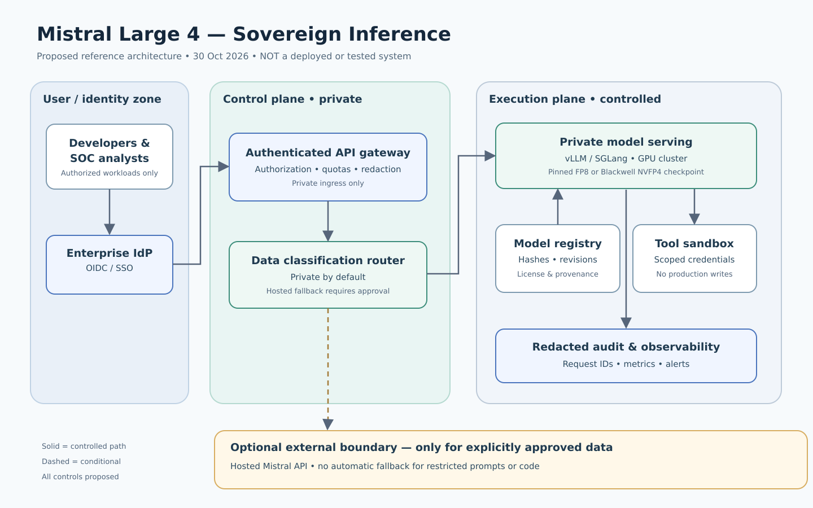
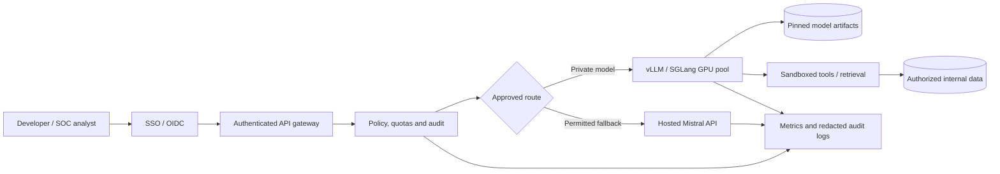

# Mistral Just Opened a 1-Trillion-Parameter AI Model — Can You Actually Self-Host It?

**Research cut-off:** 30 October 2026. **Editorial status:** Draft for technical review; commands are vendor-documented examples, **not tested deployments**.

> **The short answer:** Yes, the weights of Mistral Large 4 are now downloadable, and serving stacks support them. No, a model that activates roughly 52 billion parameters per token is **not** a 52-billion-parameter model for storage or memory planning. Self-hosting the full checkpoint is a serious hardware and operations project. A quantized GGUF can reduce the footprint, but not to ordinary 16 GB laptop scale.

## What changed on 29 October?

On **6 October 2026**, Mistral AI introduced **Mistral Large 4 (Le Chonk)** as an API-accessible public preview and said model weights would follow. On **29 October**, it published improved **open weights** after further reinforcement-learning work. Hugging Face confirmed the official **FP8** and **NVFP4** variants and community GGUF formats. This is a new deployment option, not merely another benchmark announcement.

- Official announcement: [Mistral — Mistral Large 4 is now open weight](https://mistral.ai/it/news/mistral-large-4-oss/)
- Original preview: [Mistral — Introducing Mistral Large 4, 6 October](https://mistral.ai/news/mistral-large-4/)
- [Hugging Face's 29 October technical overview](https://huggingface.co/blog/mistral-large4)
- [Official FP8 checkpoint and model card](https://huggingface.co/mistralai/Mistral-Large-4-1T-A52B)
- [Official NVFP4 checkpoint](https://huggingface.co/mistralai/Mistral-Large-4-1T-A52B-NVFP4)
- [llama.cpp team's GGUF repository](https://huggingface.co/ggml-org/Mistral-Large-4-1T-A52B-GGUF)

**Important:** Open weights are not the same as full open-source training data, nor do they guarantee low-cost local operation.

## Model architecture: the number that changes the budget

The official model card describes approximately **one trillion total parameters**, **49 billion active decoder parameters per token**, or about **52 billion active** when embeddings and output layers are included. The decoder has 128 routed experts, with four selected for each token plus one shared expert. It accepts text and images and produces text, with a **1-million-token supported context** in the model specification.

A mixture-of-experts (MoE) model saves **compute per token** by activating a subset of experts; its **full expert weight collection still needs to reside somewhere**. CPU offloading, storage streaming, or distributing the weights across devices can change placement and throughput, but do not make the missing weights disappear. A 1M context capability is a ceiling, not a promise that a particular server can afford that KV-cache footprint at production concurrency.

### Rough weight-memory floor (not a deployment quote)

For **1 trillion parameters**, simple arithmetic gives the following **idealized weight-only** storage estimates, before scales/metadata, embeddings stored at other precision, vision components, draft heads, KV cache, runtime buffers, fragmentation, and batching:

| Representation | Simple theoretical weight floor | Practical interpretation |
|---|---:|---|
| BF16 (16 bits/weight) | ~2.0 TB decimal | Multi-node/high-memory distributed deployment |
| FP8 (8 bits/weight) | ~1.0 TB decimal | Large accelerator cluster; actual checkpoint details matter |
| NVFP4 (4 bits/weight) | ~0.5 TB decimal | Blackwell-oriented serving, with quantization overhead |
| 2-bit GGUF (2 bits/weight) | ~0.25 TB decimal | Still hundreds of GB before overhead; not a laptop model |

These are **illustrative arithmetic floors**, not measured VRAM requirements or prices. The official FP8 and NVFP4 checkpoints do not necessarily use uniform precision for every tensor. Do **not** size a cluster solely from this table. A model advertised as “52B active” is **not** a 52B checkpoint. Memory capacity, interconnect bandwidth, batch size, context length, and GPU support all matter.

Hugging Face reports that a two-bit quantization can run on a **512 GB unified-memory Apple Silicon Ultra system**, while other formats typically require distributed inference. That is a useful feasibility signal, **not** a benchmark for consumer MacBooks, nor a guarantee of throughput for your workload. [Source](https://huggingface.co/blog/mistral-large4).

## Three realistic deployment choices

### Option A — Hosted API: quickest, smallest infrastructure commitment

Start with the hosted Mistral API when the goal is to evaluate coding quality, security triage, multimodal inputs, or reasoning behavior rather than demonstrate ownership of model weights. Mistral's launch announcement lists prices of **$0.70 per million input tokens**, **$0.07 per million cached input tokens**, and **$2.10 per million output tokens** at the time of release. Prices, rate limits, data-processing terms, and residency controls must be rechecked before production.

For a rough example, **10 million uncached input tokens + 2 million output tokens** would cost **$11.20 in token charges** at those published rates (10 × $0.70 + 2 × $2.10), before any other service fees. This example assumes no caching, discounts, or extra billing categories. It is not a forecast of actual usage.

Choose this when your organization needs **fast benchmarking and low initial capex**. Reject it when policy demands that prompts, code, and outputs remain exclusively on customer-controlled infrastructure and the hosted service cannot satisfy those controls.

### Option B — Private GPU serving with vLLM or SGLang

Use an authorized GPU cluster for data-residency-sensitive workloads where the infrastructure team can operate large model serving. The **official NVFP4** format targets **NVIDIA Blackwell** hardware; do not assume it works identically on older GPUs. Hugging Face provides an eight-GPU NVFP4 example with tensor parallelism and expert parallelism. **The following is an upstream recipe, not a tested result from this article**:

```bash
# Requires compatible NVIDIA Blackwell GPUs, CUDA stack,
# suitable VRAM/interconnect, supported vLLM version and disk capacity.
vllm serve mistralai/Mistral-Large-4-1T-A52B-NVFP4 \
  --config-format mistral \
  --load-format mistral \
  --tensor-parallel-size 8 \
  --decode-context-parallel-size 8 \
  --enable-expert-parallel \
  --dtype bfloat16 \
  --max-model-len 131072 \
  --max-num-seqs 16 \
  --max-num-batched-tokens 2048 \
  --gpu-memory-utilization 0.85 \
  --enable-prefix-caching \
  --enforce-eager \
  --mm_processor_cache_gb 0.0
```

Source: [Hugging Face deployment walkthrough](https://huggingface.co/blog/mistral-large4). The checkpoint's [official model card](https://huggingface.co/mistralai/Mistral-Large-4-1T-A52B) also documents vLLM and SGLang recipes. **Check exact framework and CUDA compatibility before running; never expose an unauthenticated inference server to the public internet.** Bind to a private interface, put authentication and rate limits at a gateway, and test network controls.

Once a server is actually running, a simple **smoke-test pattern** is:

```bash
curl -sS http://127.0.0.1:8000/v1/models
# Then use the model ID returned by the server in a chat request.
```

This confirms that the API responds; it does **not** establish output quality, throughput, safety, or suitability for production. Use synthetic test prompts first.

### Option C — GGUF / llama.cpp: accessible software, still massive hardware

The llama.cpp team publishes GGUF variants, including low-bit options. The Hugging Face technical article documents a `Q2_K` example:

```bash
# Requires a host with sufficient RAM/VRAM and compatible llama.cpp tooling.
# Do not run on a 16 GB machine expecting the full 1T model to fit.
llama serve -hf ggml-org/Mistral-Large-4-1T-A52B-GGUF:Q2_K
```

Source: [Hugging Face technical overview](https://huggingface.co/blog/mistral-large4) and [GGUF repository](https://huggingface.co/ggml-org/Mistral-Large-4-1T-A52B-GGUF). The 2-bit format trades quality and sometimes speed for memory savings; benchmark it on your own task set. “Supported by llama.cpp” does **not** mean “works well on every laptop.”

For smaller computers, compare **a smaller open-weight model** against the hosted Large 4 API instead of buying inadequate hardware for a 1T model. This is an architectural recommendation, not a claim that a specific smaller model has been evaluated here.

## A proposed enterprise reference architecture

The following is a **design proposal**, not an implementation deployed or verified during this research.





**Trust boundaries:** Users must authenticate; the gateway enforces request authorization and per-tenant quotas; inference workers cannot directly write to production systems; retrieval respects document ACLs; tools run with short-lived, scoped identities in isolated sandboxes. Hosted fallback must be **disabled by default** for restricted data and explicitly approved per classification. Use a pinned checkpoint revision and verify checksums.

The companion [architecture decisions document](../../../architecture/2026-10-30-mistral-large-4-self-hosting-design-decisions.md) records decisions and trade-offs separately.

## Cybersecurity: benchmark promise versus operational proof

Mistral reports **51% on the Artificial Analysis Cyber Index** and **96.6% refusal on a selection of harmful cyber prompts**. The Hugging Face overview also describes an **82% result on a particular vulnerability reproduction-and-patching task**; **82% and 51% are different measurements and should not be conflated**. Benchmark versions, evaluation subsets, and methodologies differ.

Do not interpret a high refusal rate as a guarantee that the model cannot be misused, nor a strong patching score as proof that it can autonomously modify production. Mistral itself notes the potential for cyber misuse and says guardrails are being adjusted. Its specialized advanced-cyber variant is offered only to vetted enterprise design partners, not as an unrestricted public service.

For a defensive pilot, select **owned or explicitly authorized** test repositories. Require:
1. A fixed set of known vulnerabilities and clean control examples.
2. A sandbox with outbound egress denied by default.
3. Read-only code access for discovery; isolated test execution.
4. Generated patches as **pull requests**, never automatic merges.
5. Human review, regression tests, SAST/DAST where relevant, and rollback.
6. Measurements of recall, precision, false positives, regression rate, token use, latency, and total cost.

Do not evaluate on third-party systems without permission.

## Cost model: when does self-hosting make sense?

Calculate total cost of ownership (TCO), not just GPU hourly price:

```text
Monthly self-hosted TCO =
  GPU reservation / depreciation
+ CPU, RAM, NVMe and interconnect
+ datacenter power and cooling (or cloud hosting)
+ networking and storage transfer
+ platform/SRE/on-call operations
+ monitoring, backups and security
+ licensing / support where applicable
```

Compare against hosted **cost per successful evaluated task**, not just cost per token. A self-hosted cluster with low utilization can be dramatically more expensive than API inference; a heavily utilized private cluster can make sense when data residency, availability, customization, or workload economics justify it. Do not use speculative GPU rental prices as if they were quotes.

### License matters

The checkpoint is under the **Mistral Ecosystem Open-Weight License**, a modified MIT license. Mistral says use, modification, fine-tuning, and commercial deployment are permitted, **but a business offering Model-as-a-Service commercially needs a separate license**. Read the [actual license text](https://huggingface.co/mistralai/Mistral-Large-4-1T-A52B/blob/main/LICENSE) and obtain legal review for resale or hosted offerings. Do not label it unconditionally “MIT licensed.”

## A reproducible evaluation plan (without pretending to have the hardware)

| Test | How to run | Pass criterion |
|---|---|---|
| API compatibility | Send a synthetic chat request; inspect response and error paths | Stable schema and documented errors |
| Code review | Feed a fixed, owned test repository with known issues | Findings verified by independent tests |
| Patch quality | Generate a PR, run regression/security tests | No critical regressions; human approval |
| Data protection | Insert synthetic secrets and sensitive-looking records | No leakage into logs or unauthorized destinations |
| Reliability | Simulate inference timeouts and worker loss | Bounded retries, fallback policy respected |
| Performance | Sweep prompt length, concurrency and reasoning mode | Measured latency, throughput, tokens and cost |
| Residency | Audit egress and storage paths | No forbidden external data transfer |
| Quantization | Compare same tasks across FP8/NVFP4/GGUF where feasible | Explicit quality–cost trade-off |

Publish **hardware SKU, driver/CUDA, checkpoint revision, quantization, context, concurrency, and measurements** alongside any future benchmark. The examples above are not measurements from this publication.

## YouTube production package

**Primary title:** Mistral Just Opened a 1-Trillion-Parameter AI Model — Can You Actually Self-Host It?

**Alternate title:** Mistral Large 4 Is Open-Weight — Here's the Real GPU and Licensing Catch

**Thumbnail text:** `1 TRILLION PARAMS` / `CAN YOU RUN IT?`

**Opening hook:** “Mistral just released the weights of a one-trillion-parameter AI model. But here's the catch: only about 52 billion parameters are active per token, and that does **not** mean it fits in 52-billion-parameter memory. Before you download hundreds of gigabytes, let's examine the real hardware, software, licensing, and sovereign AI choices.”

**Suggested chapters:** 0:00 What actually shipped; 1:00 1T vs 52B active; 3:00 weight-memory arithmetic; 5:00 FP8 vs NVFP4 vs GGUF; 7:00 architecture and access controls; 10:00 hosted vs private TCO; 12:00 defensive security evaluation; 14:00 final deployment decision.

**Audience:** AI infrastructure architects, cloud/DevOps engineers, enterprise cybersecurity teams, model-serving practitioners, and technically serious AI learners.

**Opportunity and competition assessment:** The **29 October weight publication** is an independently verifiable, new demand trigger. It enables new tutorials that were not feasible during the 6 October API-only preview. A targeted search did not establish a reliable count of existing YouTube videos or search-volume growth, so **low creator supply is a hypothesis**, not a measured fact. The differentiation is the memory/TCO/license/security architecture walkthrough rather than another launch recap.

**Monetization fit:** Enterprise AI architecture workshops, GPU capacity planning, model-serving training, cloud platform consulting, and cybersecurity evaluation education. No revenue forecast is implied.

## Conclusion

Mistral Large 4's open-weight release is significant because teams can now **choose where the model runs**, rather than relying solely on a hosted API. But ownership of weights does not remove the physics of a trillion-parameter checkpoint, nor the security and operating responsibilities of production inference. For most small teams, start with a hosted baseline; for regulated or high-utilization workloads, build a measured private pilot. Treat model performance claims as hypotheses until reproduced on your own tasks.

## Sources and verification notes

1. Mistral AI, **Mistral Large 4 open-weight release**, 29 October 2026: https://mistral.ai/it/news/mistral-large-4-oss/
2. Mistral AI, **Introducing Mistral Large 4**, 6 October 2026: https://mistral.ai/news/mistral-large-4/
3. Hugging Face, **Welcome Le Chonk: Mistral Large 4**, 29 October 2026: https://huggingface.co/blog/mistral-large4
4. Mistral AI, **FP8 model card and vLLM/SGLang deployment recipes**: https://huggingface.co/mistralai/Mistral-Large-4-1T-A52B
5. Mistral AI, **NVFP4 model checkpoint**: https://huggingface.co/mistralai/Mistral-Large-4-1T-A52B-NVFP4
6. llama.cpp community, **GGUF model formats**: https://huggingface.co/ggml-org/Mistral-Large-4-1T-A52B-GGUF
7. Mistral AI, **Mistral Ecosystem Open-Weight License text**: https://huggingface.co/mistralai/Mistral-Large-4-1T-A52B/blob/main/LICENSE
8. Reuters, **Mistral publicly releases Large 4, targets cybersecurity users**, 29 October 2026: https://www.reuters.com/legal/litigation/mistral-ai-publicly-releases-large-4-targets-cybersecurity-users-2026-10-29/

**Disclosure:** This article synthesizes publicly available primary-source documentation and explicitly labeled arithmetic estimates. No Mistral Large 4 weights were downloaded, no GPU deployment was executed, and no throughput or cybersecurity benchmark was independently reproduced for this article.
