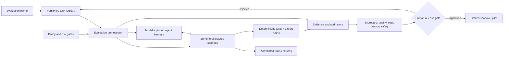

# The Best AI Agent Scores Just 12% on GDPx: What Enterprises Must Test Before Deployment

**Publication date:** November 3, 2026 · **Evidence cutoff:** November 3, 2026

> **Key distinction:** GDPx's 12.0% is an equally weighted composite of domain scores, mixing binary and partial-credit grading, averaged across three attempts. It is **not** a claim that an agent succeeds on exactly 12% of every real-world job, nor a simple count of 25 completed tasks out of 206.

## Executive summary

On **November 2, 2026**, SemiAnalysis published **GDPx v1.0**, a benchmark of **206 agentic tasks across 11 specialist domains**, developed with **14 data partners**. Its first leaderboard places **Claude Opus 5.5 at 12.0%**, **Gemini 4 Carbon at 10.9%**, and **GPT-6 Astra at 9.6%**. These are **SemiAnalysis-reported scores**, not independent replications. The test includes realistic environments, tool use, multi-step work and up to eight hours for most tasks. Unlike one-shot document generation, the agent must discover relevant information, operate software and produce verifiable outputs. [1][2]

The immediate implication is not that AI agents are useless. It is that success on coding demonstrations or short-form leaderboards cannot establish readiness for expensive, regulated, long-horizon business workflows. Organizations should evaluate **their own tasks, risk, tools, and cost per accepted outcome**, rather than buy a model based on one aggregate rank.

## What changed on November 2?

GDPx was newly released with a public interactive leaderboard, domain comparisons and a methodology write-up. The benchmark includes chip design, cybersecurity, biology, finance, legal, quant trading, recursive self-improvement, hardware design, materials science, alignment, and software engineering. SemiAnalysis deliberately chose economically valuable specialist domains, not a representative sample of all jobs or occupations. [1]

**Why this is a YouTube opportunity:** The strongest educational angle is a hands-on tutorial explaining why a high-scoring model can still fail at realistic agent workflows—and how to construct a reproducible enterprise evaluation pipeline. It addresses DevOps/platform engineers, AI architects, technical managers and professional learners. Demand is suggested by the new benchmark and active technical coverage; **YouTube search-volume, audience-growth and competing-creator counts have not been independently measured**, so low competition remains an unverified hypothesis.

## Verified headline results

| Model | GDPx v1.0 composite | SemiAnalysis-listed average cost/task |
| --- | ---: | ---: |
| Claude Opus 5.5 | 12.0% | $51.41 |
| Gemini 4 Carbon | 10.9% | $16.29 |
| GPT-6 Astra | 9.6% | $53.99 |
| Muse Wonder Full | 9.0% | Not listed |
| GPT 6.1 Sol | 8.4% | $9.80 |
| DeepSeek 4.1 Flash 1017 | 5.4% | $0.94 |
| GPT-6 Luna | 5.1% | $0.92 |

**Source:** GDPx public leaderboard, accessed November 3, 2026 [2]. The site exposes 13 model scores from 20 tested. Prices are benchmark-run averages, **not** universal API prices or total enterprise operating costs. Do not infer general availability of a model from its presence on the leaderboard.

### Why 12% is not a universal failure rate

The headline combines different graders, including partial credit, and gives equal weight to each of 11 domains and to each partner within a domain. The published methodology says each model is run in its native agent harness where available (for example Claude Code, Codex, Antigravity); others use OpenCode. Consequently, **the evaluated unit is a model-plus-harness-plus-tool configuration**, not an isolated language model. Default task duration is eight hours, sometimes shorter. Reported performance averages three attempts. [1][2]

That creates at least five interpretation risks:

1. **Domain mismatch:** a general average can hide strong or weak performance in your own workflow.
2. **Harness confounding:** tool access, prompt design, orchestration and sandbox behavior influence scores.
3. **Task-selection bias:** high-value specialist domains are intentionally overrepresented.
4. **Grading comparability:** a partial-credit score and a binary completion score are not identical.
5. **Independent replication:** many task artifacts are private; external researchers cannot fully reproduce every score.

SemiAnalysis reports that safety filters affect some cyber, biology and alignment tasks, and that finance and legal tasks are especially challenging. These are the benchmark authors' interpretations; they should not be generalized to production safety or occupational replacement. [1]

## GDPx versus GDPval: what is actually different?

The authors contrast GDPx with OpenAI's GDPval, which tests more tightly specified knowledge-work deliverables. GDPx emphasizes interactive, long-horizon work in realistic environments: for example, agents must search large simulated deal rooms, interact with engineering software or work within sandboxed services. The authors criticize older benchmarks for missing this environmental complexity; that critique is **their assessment**, not proof that all other benchmarks are invalid. [1][3]

A useful evaluation hierarchy is:

| Level | Example | What it proves | What it cannot prove |
| --- | --- | --- | --- |
| Unit test | Answer a technical question | Narrow knowledge | Tool reliability |
| Tool integration | Read a repo and open a PR | Basic agent workflow | Sustained autonomy |
| Simulated work | Complete an isolated multi-hour case | End-to-end capability | Production reliability |
| Shadow mode | Propose changes against real inputs, no writes | Realistic error patterns | Safe autonomous writes |
| Controlled production | Human-approved changes with rollback | Operational value in scope | Safety outside scope |

## Reference architecture: an enterprise agent evaluation pipeline

This diagram is a **proposed architecture for readers**, not a depiction of SemiAnalysis's internal infrastructure.



### Implementation blueprint (vendor-neutral)

**Step 1 — Build a representative task set.** Start with 20–50 internally approved examples: repository fixes, incident triage, documentation updates, infrastructure reviews or customer-support workflows. Include known-hard cases, ambiguous requests and failures. Document consent, provenance and expected outcomes.

**Step 2 — Freeze the environment.** Version task instructions, fixture snapshots, model identifiers, harness versions, tool permissions, timeout and random seeds where supported. Run tasks inside isolated containers or VMs; disable outbound networking unless explicitly needed.

**Step 3 — Define grading before running.** Combine objective checks (tests, schema validation, policy compliance) with blinded expert review for judgment-heavy outcomes. Allow multiple valid solutions; do not reward a specific implementation path unless required by the task.

**Step 4 — Measure repeated runs.** Capture success, partial completion, hallucinated evidence, security violations, token usage, wall time, compute and reviewer time. Report distributions and uncertainty, not a single heroic demo.

**Step 5 — Enforce least privilege.** Give agents read-only access by default; provide scoped temporary write credentials only for approved sandbox tasks. Block access to production secrets and require explicit human authorization before external actions.

**Step 6 — Evaluate failure and rollback.** Inject benign tool failures, missing files and conflicting instructions. Ensure the agent stops safely, preserves evidence and does not bypass approval when uncertain.

**Step 7 — Pilot in shadow mode.** Run on current business inputs without executing suggested changes. Compare with human baseline; promote only task categories that meet explicit acceptance criteria.

### Minimal scorecard template

```yaml
evaluation:
  dataset_version: "2026-11-03-v1"
  task_family: "repository-maintenance"
  attempts_per_task: 3
  max_duration_minutes: 60
  tool_policy: "sandbox-readwrite-no-external-egress"
  approval_required_for_external_actions: true
metrics:
  - accepted_outcome_rate
  - task_completion_time_p50_p95
  - cost_per_accepted_outcome
  - unauthorized_action_count
  - reviewer_minutes_per_task
  - rollback_success_rate
release_gates:
  unauthorized_action_count: 0
  accepted_outcome_rate_min: "set from measured baseline"
  human_signoff: true
```

This is an **illustrative specification**, not a ready-made GDPx runner. It deliberately avoids claiming access to private GDPx tasks.

## Practical evaluation: cost per accepted result

Suppose agent A costs $2 per attempt and passes 40% of **your** tasks, while agent B costs $8 per attempt and passes 80%. Ignoring retries and human review, A costs about **$5 per accepted task** and B about **$10**. But if failures trigger expensive rework or compliance exposure, the apparent cheaper option may be worse. The correct optimization target is expected business value subject to risk limits, not raw token price.

A useful operational formula is:

```text
effective_cost_per_accepted_result =
  (model + tool + compute + review + rework costs)
  / number_of_human_accepted_results
```

Always measure on your own task mix. Do not substitute GDPx's published cost/task figures for your procurement quote.

## Security and compliance considerations

Long-running agents may read proprietary data, execute commands, navigate tools and propose persistent changes. Treat their inputs and retrieved documents as **untrusted content**, not as authority. Use network egress controls, secret isolation, workload identities, rate limits, human approval, append-only audit logs and reproducible artifacts. Validate generated patches with tests and scanners; never assume that passing a benchmark grants permission to act in production.

For cyber or other sensitive tasks, use authorized defensive simulations and never test against third-party systems without permission. Respect data minimization, contractual boundaries, export restrictions and sector-specific obligations.

## Limitations and what to watch next

- GDPx v1.0 launched November 2; the public leaderboard may change. Record access dates and version.
- Most tasks and full grading materials are not publicly reproducible.
- The composite weights specialist domains equally and is not representative of all jobs.
- Model/harness combinations, safety filters and access conditions vary.
- The 12.0% score is a benchmark composite, not a general workplace productivity estimate.
- No reliable YouTube demand or supply counts were established for this specific tutorial angle.

## YouTube production package

**Primary title:** The Best AI Agent Scores Just 12% — Here's How to Test Yours Before Production

**Alternative title:** Claude, Gemini & GPT-6 Fail This New Agent Benchmark: GDPx Explained

**Thumbnail copy:** "BEST AGENT: 12%?" (add "GDPx composite" in video context)

**Search intent:** GDPx benchmark explained; AI agent evaluation tutorial; enterprise AI readiness; Claude vs Gemini vs GPT-6 agent benchmark.

**Suggested chapters (12–15 minutes):**
1. The November 2 announcement and the 12% headline.
2. What GDPx really measures.
3. Why a composite score is not a job-success probability.
4. Model, harness, cost and domain differences.
5. Live demo: build an isolated mini-evaluation with synthetic tasks.
6. Architecture: approval gates and audit evidence.
7. Scorecards, limitations and next steps.

**Call to action:** Download the evaluation checklist, reproduce the synthetic demo, and compare two models on tasks that matter to your organization. Invite viewers to share anonymized results—not sensitive logs.

**Monetization paths:** advanced agent-evaluation workshop, enterprise readiness assessments, DevSecOps training, and a downloadable evaluation scorecard. These are proposed offerings, not demonstrated market demand.

## References (primary sources)

1. SemiAnalysis, *GDPx: Measuring Frontier Model Capabilities Across the Most Valuable Domains*, **November 2, 2026**. https://newsletter.semianalysis.com/p/gdpx-measuring-frontier-model-capabilities
2. SemiAnalysis, *GDPx v1.0 leaderboard*, accessed **November 3, 2026**. https://gdpx.semianalysis.com/
3. OpenAI, *GDPval: Evaluating AI Model Performance on Real-World Economically Valuable Tasks* (background). https://openai.com/index/gdpval/

**Editorial note:** Scores, prices and methodological claims above are attributed to their publishers. This article does not assert an independent replication or a live implementation of the proposed reference architecture.
