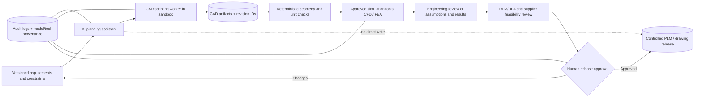

# AI Is Designing Real Hardware: What OpenAI's Mazda and Racing Projects Actually Prove

**Suggested YouTube title:** AI Designed a Real Device — Can It Engineer Your Next Car Part?

**Thumbnail concept:** "AI → CAD → FACTORY?" with a prominent human verification checkpoint.

**Audience:** automotive engineers, mechanical designers, platform engineers, CAD automation developers, engineering students, and technical educators.

**Publication trigger:** OpenAI's **3 November 2026** engineering research announcement, not the earlier general-purpose AI-agent launches. This is a new application-specific report about physical engineering, with named automotive collaborators and an internal hardware prototype. The article does **not** assert independently reproduced performance or general access to collaborator tooling.

## Executive summary

On 3 November 2026, OpenAI described work using GPT-6 Astra and Codex to support physical product engineering. Its reported examples include a small prototype device designed across enclosure, PCB, and software disciplines; CAD and simulation assistance inside OpenAI hardware teams; reverse engineering with Chip Ganassi Racing; and aerodynamic and crash-safety exploration with Mazda. These are **reported demonstrations and collaborations**, not proof of unattended, safety-certified manufacturing.

The most important detail may be the limitation OpenAI disclosed: even its prototype needed manufacturing review and several iterations because the model did not consistently account for production constraints, tolerances, or assembly requirements. That gap is where professional engineering workflows, validation, and traceability matter.

## What was actually announced

OpenAI says two team members worked with Astra to design a device for interacting with Codex in less than a week as a side project; a contract manufacturer built a small batch of prototypes in under a month. The company reports that its hardware teams' model usage, measured in tokens, grew 23-fold since February. **Token usage is not a productivity or quality benchmark.**

The announcement also reports an internal BenchCAD 2.0 score of **0.875** for a newer internal model versus **0.594** for GPT-6 Astra at its highest reasoning setting. These are **company-reported scores** for specific CAD-related tasks, not evidence of equivalent manufacturing quality or general engineering success.

For Chip Ganassi Racing, the collaboration explores converting 3D scans of existing parts into editable CAD models and 2D drawings, with engineers reviewing accuracy and manufacturability. For Mazda, the announced research explores aerodynamic and crash-safety design through simulations, including nose-shape variation and airflow. The source does not publish a general-purpose CAD/CFD agent package or independent end-to-end performance data.

## The engineering workflow: from requirements to released drawings

A model can propose geometry, write scripts, or prepare simulation inputs. It cannot substitute for an engineering authority that checks loads, boundary conditions, units, materials, manufacturability, tolerances, safety requirements, and revision history.

A useful distinction:
- **Geometric plausibility:** does a CAD model look correct?
- **Engineering validity:** are dimensions, constraints, loads, and simulation assumptions correct?
- **Manufacturability:** can the part be produced and assembled at required yield and cost?
- **Certification and release:** have accountable engineers approved applicable tests and documentation?

A strong AI-assisted workflow separates these gates rather than allowing a fluent model output to masquerade as verified design.

## Proposed reference architecture (not an OpenAI or Mazda deployment)



This diagram is **proposed guidance**, not a claim about the collaborators' infrastructure. CAD, simulation, and product-lifecycle management systems differ by organization.

### Implementation blueprint: a reproducible educational demonstration

**Scope:** Design a non-safety-critical bracket or small enclosure with synthetic requirements. Do not use the tutorial to certify automotive, aerospace, medical, or structural parts.

1. Define requirements in a versioned YAML or JSON file: envelope dimensions, fastener positions, nominal loads, material assumptions, allowed units, manufacturing method, and acceptance criteria.
2. Generate parametric geometry using an established CAD scripting interface. Treat AI-generated scripts as untrusted code: run them in a restricted container or VM with no production credentials and no uncontrolled network access.
3. Validate basic invariants independently: bounding-box dimensions, minimum thickness, hole alignment, volume, interference, and consistent units.
4. Export STEP and drawing previews with stable revision IDs. Store input prompts, tool versions, generated scripts, and hashes of artifacts.
5. Run a simulation **only if** an engineer has approved loads, boundary conditions, mesh assumptions, and material data. Label outputs preliminary.
6. Compare multiple candidate designs on mass, estimated cost, fit, manufacturability, and uncertainty. Never choose by an LLM's self-assessment alone.
7. Require human review before any drawing is issued to a supplier or any geometry enters a controlled product baseline.

Example requirements skeleton:

```yaml
project: training-bracket
revision: 0.1
units: mm
safety_classification: educational_non_safety_critical
constraints:
  max_width_mm: 80
  max_height_mm: 60
  min_wall_mm: 3
  fastener_holes: 2
checks:
  - geometry_within_envelope
  - units_consistent
  - hole_count_matches
  - no_unapproved_external_network
release:
  requires_human_engineer_approval: true
```

The example intentionally omits structural loads: without validated load cases and material properties, **no structural fitness claim is possible**.

## Why the technical distinction matters

### CAD generation is not CAD verification

A visually convincing surface can conceal self-intersections, open solids, invalid constraints, unmachinable undercuts, or impossible assemblies. Automated checks can reject obvious errors, but cannot replace discipline-specific review.

### CFD and FEA are sensitive to assumptions

An agent may correctly automate a solver invocation while selecting an invalid mesh, turbulence model, material curve, or boundary condition. The resulting numbers can appear precise while being wrong. Use reference cases, convergence studies, uncertainty checks, and qualified reviewer sign-off.

### Scan-to-CAD introduces metrology uncertainty

Reconstruction from scans must account for resolution, noise, coordinate systems, missing surfaces, and fit tolerances. Compare the reconstructed model against the source point cloud and physical measurements, and record deviations.

### Agent tool access changes the security model

CAD plugins, shell tools, document repositories, and simulation queues are privileged surfaces. An AI agent should have least-privilege access to **copies** of engineering files; it should not silently modify released drawings or product lifecycle records. Prompt injection may arrive through imported documents or model comments.

## Suggested engineering evaluation scorecard

| Dimension | Measurement | Minimum evidence |
|---|---|---|
| Geometry | Valid solid, correct envelope, constraint satisfaction | Independent CAD checker |
| Simulation | Solver convergence and reference-case agreement | Approved setup and reviewed report |
| Manufacturing | Tolerance stack, process feasibility, assembly | DFM/DFA review |
| Security | No unauthorized tool calls or data exfiltration | Isolated execution logs |
| Traceability | Requirements-to-revision mapping | Artifact hashes and approval record |
| Efficiency | Engineer time, compute cost, rework rate | Controlled baseline comparison |

Avoid claiming improvement until a representative baseline and repeated trials exist.

## Architecture and design decisions

The companion document at `architecture/2026-11-04-ai-automotive-cad-design-decisions.md` records the rationale, alternatives, and trade-offs for isolation, version control, deterministic checking, simulation review, human release gates, and telemetry. A separate conceptual diagram is stored under `diagrams/2026-11-04-ai-automotive-cad-context.svg`.

## Caveats and fact-checking

- The published engineering examples are **vendor-described**; this article has not independently reproduced them.
- The benchmark numbers concern the described BenchCAD 2.0 tasks, not full physical-product design.
- The manufacturer prototype required review and rework.
- The Mazda and racing collaborations do not imply autonomous safety certification, mass-production deployment, or public availability of internal tools.
- Hardware-team token growth measures use, not productivity.
- Demand is plausible because of the new engineering announcement and cross-disciplinary relevance, but **no reliable YouTube search-volume or competing-creator count was verified**. Low competition is a hypothesis, not a measured result.

## YouTube production outline (10–14 minutes)

1. **Hook (0:00–0:45):** "AI helped design a physical device. But did it pass manufacturing review?"
2. **Evidence (0:45–3:00):** What OpenAI reports about the device, BenchCAD, Mazda, and Chip Ganassi Racing.
3. **Architecture (3:00–5:00):** Requirements → isolated CAD worker → deterministic checks → simulation → engineer sign-off.
4. **Safe demo (5:00–9:30):** Parametric educational bracket with versioned constraints and automated geometry checks.
5. **Failure modes (9:30–12:00):** Units, tolerances, mesh validity, scan uncertainty, and tool permissions.
6. **Takeaway (12:00–14:00):** "AI can accelerate iteration; engineering validation still owns the release."

**CTA:** "Subscribe for reproducible AI engineering and DevOps tutorials. Download the reference architecture and adapt it to a non-safety-critical training project."

## Primary sources and further reading

1. OpenAI, **3 November 2026**, *Accelerating engineering for the physical world*: https://openai.com/index/accelerating-engineering-for-the-physical-world/
2. OpenAI, **2 November 2026**, *LifeVal* (related but distinct evaluation of everyday-life tasks): https://openai.com/index/lifeval/
3. NIST, *AI Risk Management Framework* (general governance framework): https://www.nist.gov/itl/ai-risk-management-framework
4. NIST, *Secure Software Development Framework* (software lifecycle security principles): https://csrc.nist.gov/Projects/ssdf
5. OpenAI, *GPT-6 Astra model information* (follow linked product documentation from the primary announcement): https://openai.com/index/accelerating-engineering-for-the-physical-world/

**Editorial note:** Check the source for any subsequent corrections before filming; do not reuse collaborator imagery or footage without appropriate permission.
