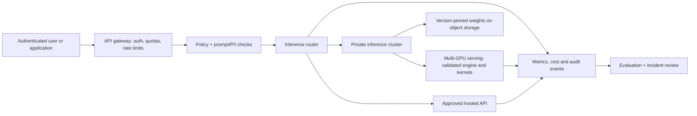

# Kimi K3.1 Pro's 1.56 TB Open Weights Are Here: The Real Cost, License and Architecture of Self-Hosting

**Suggested YouTube title:** Kimi's 2.8 TRILLION Parameter Model Is Downloadable — But Can You Actually Run It?

**Thumbnail concept:** “2.8T PARAMETERS / 1.56 TB / YOUR GPU?” with a storage-to-GPU pipeline. **Audience:** AI infrastructure engineers, DevOps teams, self-hosting enthusiasts, enterprise architects. **CTA:** Download the model-sizing checklist and compare your inference budget with hosted API costs.

## The new development — 4 November 2026

Moonshot AI originally introduced Kimi K3.1 Pro in October, promising open weights by 4 November. The material change is that the actual **model files are now publicly listed** at https://huggingface.co/moonshotai/Kimi-K3.1-Pro/tree/main. The repository shows **1.56 TB** and numbered safetensors shards running to **96**; its model card and custom license are accessible. This is materially different from a preview or an API-only model. The public release was reported on 4 November; the repository itself confirms present availability, not a precise upload timestamp. [1][2]

The official card describes **2.8 trillion total parameters**, **104 billion activated parameters**, a **1,048,576-token context length**, and **MXFP4 weights / MXFP8 activations** produced using quantization-aware training. [1] These are vendor-reported specifications, not independently benchmarked deployment results.

## Why 104B active does not mean a 104B storage footprint

Kimi is a mixture-of-experts (MoE) model: a subset of experts participates in each token's computation, but the full expert collection must be stored or made accessible for serving. Therefore **activated parameters describe approximate compute participation, not the model's total resident weight requirement**. The 1.56 TB repository is a useful disk-transfer baseline; practical GPU or CPU memory requirements also depend on placement, engine, quantization representation, communication, KV cache, batch size and context. Never infer “fits on one 104B-sized GPU” from the active-parameter figure.

A rough illustrative lower bound for raw weight placement is 1.56 TB / 8 = **195 GB per accelerator** across eight equal partitions *before* runtime overhead. This arithmetic does **not** demonstrate that eight particular GPUs will serve the model: real sharding and supported kernels must be verified. A one-million-token *maximum supported context* is not a promise that a given installation can serve that context at useful latency or concurrency.

## What the license really allows

The repository uses the **Kimi K3.1-Pro License**, not Apache-2.0 or MIT. Its text permits use, modification and distribution subject to conditions. For a licensee (including affiliates) operating a qualifying **Model-as-a-Service** business with **over US$20 million aggregate revenue in any consecutive 12 months**, a separate Moonshot agreement is required **before commercial use**. A separate prominent-name requirement applies to certain commercial products with **over 100 million monthly active users or over US$20 million monthly revenue**. The license exempts defined internal use and access through official products/certified partners from those sections. Read the full license and obtain legal advice for borderline cases; these conditions are not a generic prohibition on small-business commercial deployment. [3]

## Three realistic deployment paths

| Path | Who it suits | Advantages | Main constraints |
| --- | --- | --- | --- |
| Official/approved hosted API | Teams validating use cases quickly | No large cluster purchase; faster pilot | Vendor/data processing terms, recurring tokens, provider limits |
| Dedicated enterprise GPU cluster | Teams with sustained utilization and residency needs | More infrastructure control; potential utilization economics | 1.56 TB artifacts, multi-node networking, supported MXFP4 kernels, operational complexity |
| Small local workstation | Educational experiments with **smaller models** | Low-cost hands-on learning | Full K3.1 Pro is not a credible ordinary laptop target; use a smaller model rather than implying parity |

### Proposed reference architecture (NOT a verified deployment)



**Security boundary:** Never expose an inference server directly to the internet. Use workload identity, egress restrictions, encrypted artifact transport, hash/commit pinning, scoped secrets and independent audit logging. Treat model-generated commands as untrusted suggestions requiring sandboxed execution and approval.

### Proposed rollout sequence

1. **Verify the artifact and license.** Record model repository revision, license version, file manifest and checksums. Review the repository's custom Python code before allowing `trust_remote_code`.
2. **Define the workload.** Measure real prompt/output token distributions, request concurrency, context length, throughput targets and data sensitivity. Use representative tasks rather than synthetic prompts alone.
3. **Validate serving support.** Moonshot's model page lists vLLM and SGLang integration examples, but examples do not establish compatibility with your specific versions, GPUs or kernels. Pin a tested software stack; do not use floating `latest` tags in production. [1]
4. **Benchmark on a non-production cluster.** Measure cold start, throughput, latency p50/p95/p99, OOM behavior, KV-cache utilization, GPU interconnect traffic and quality on domain-specific tasks.
5. **Evaluate alternatives.** Compare an approved hosted API, smaller local models, and full self-hosting on equivalent tasks. Include amortized GPUs, energy, storage, networking, operations, downtime and licensing review.
6. **Roll out gradually.** Route a limited internal pilot through a gateway with quotas, monitoring, rollback and human review for consequential outputs.

### Cost model (fill with your own measurements)

```text
Self-hosted monthly TCO =
  GPU lease or amortization
+ electricity and cooling
+ storage and transfer
+ networking
+ SRE/security operations
+ backup, monitoring and downtime allowance

Hosted monthly cost =
  (input_tokens / 1e6 × contracted_input_price)
+ (output_tokens / 1e6 × contracted_output_price)
+ platform/network charges
```

Avoid comparing list-price token rates to an assumed 100% utilized GPU cluster. Estimate break-even with actual utilization and p95 latency requirements.

## Architecture decisions and trade-offs

**ADR-01: API-first proof of value.** Prefer an approved API for initial workload discovery; alternative: acquire GPUs immediately. Trade-off: API reduces sunk costs but may restrict data placement.

**ADR-02: Separate artifact storage from inference.** Use versioned, checksum-verified storage and a controlled promotion process; alternative: fetch live from the public hub at startup. Trade-off: operational overhead for reproducibility and supply-chain control.

**ADR-03: Keep the gateway independent of the model server.** Enforce auth, quotas and telemetry centrally; alternative: direct public serving endpoint. Trade-off: small latency cost for significantly improved control.

**ADR-04: Validate hardware, not parameter-count marketing.** Benchmark exact GPU topology and context; alternative: extrapolate from active parameter count. Trade-off: slower procurement for lower deployment risk.

**ADR-05: Pin runtime and review custom code.** Alternative: blindly use `trust_remote_code` and newest containers. Trade-off: compatibility maintenance for stronger supply-chain assurance.

**ADR-06: Maintain a smaller-model fallback.** Alternative: make every request depend on the giant cluster. Trade-off: possible quality reduction in exchange for cost and availability resilience.

**ADR-07: Legal gate before external service.** Record the specific Model-as-a-Service and attribution tests; alternative: assume “open weights” equals unconditional open-source licensing. Trade-off: review time prevents contractual surprises.

See the companion ADR document for decision rationale and operational acceptance criteria.

## Benchmark and safety caveats

The model card contains vendor-assembled comparisons across coding, agentic, and cybersecurity tasks. Different evaluation harnesses, reasoning budgets and model settings can change rankings; these figures should not be framed as independently reproduced. Model availability does not establish safe autonomous operation. Its custom license should not be described as OSI-approved without evidence. A 1.56 TB download is not evidence of inexpensive local inference. Neither a working K3.1 Pro deployment nor a GPU throughput result was produced for this article.

## YouTube production outline

**0:00 Hook:** A 2.8T model is now downloadable; why can't a typical laptop run it? **0:45 News:** show the official model files and license. **2:00 Architecture:** total versus active parameters, MoE and memory. **4:00 License:** the two distinct revenue/attribution tests. **6:00 Diagram:** API-first versus private cluster. **8:30 Decision framework:** workloads, costs, security and benchmarks. **11:00 CTA:** encourage viewers to evaluate their own hardware rather than copy unverified deployment claims.

**Search intent:** “Kimi K3.1 Pro download”, “Kimi K3.1 Pro GPU requirements”, “Kimi K3.1 Pro license”, “Kimi K3.1 Pro vLLM”, “Kimi K3.1 Pro self host”.

**Opportunity assessment:** The weight release is a verified, materially new trigger. Its hardware/license tutorial angle is distinct from earlier cyber-benchmark coverage. No reliable YouTube search-volume or competing-creator census was established; **high demand / low supply is a hypothesis, not a measured conclusion**.

## Primary sources and references

1. Moonshot AI official model card and specifications: https://huggingface.co/moonshotai/Kimi-K3.1-Pro
2. Official public files listing (1.56 TB): https://huggingface.co/moonshotai/Kimi-K3.1-Pro/tree/main
3. Official custom license: https://huggingface.co/moonshotai/Kimi-K3.1-Pro/blob/main/LICENSE
4. Moonshot AI technical blog: https://www.kimi.ai/blog/kimi-k3-1-pro
5. Official model card deployment examples (vLLM/SGLang): https://huggingface.co/moonshotai/Kimi-K3.1-Pro#4-deployment-and-availability

**Editorial note (5 November 2026):** Validate current serving compatibility, price sheets and license text again immediately before filming. No benchmark, production deployment, GPU compatibility or audience metric is represented as independently measured here.
