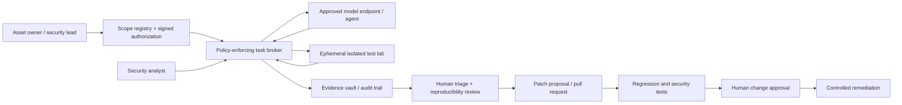

# GPT-6 Cyber Is Rated Critical: How to Build a Safe AI Vulnerability-Research Pipeline

**Recommended YouTube title:** GPT-6 Cyber Found 81 Firefox Bugs — Here's How to Deploy AI Security Agents Safely

**Publication trigger:** OpenAI announced GPT-6 Cyber on **November 5, 2026** and published its system card the same day. This is a new model and access program, not a repetition of earlier agent-security reporting.

**Audience:** SOC engineers, AppSec leads, DevSecOps practitioners, cloud architects, security educators, and CISOs.

## Executive summary

OpenAI describes GPT-6 Cyber as a specialized variant of GPT-6 Astra for authorized cybersecurity research. It assigns the model a **Critical cybersecurity capability** classification under its Preparedness Framework. This classification concerns capability and risk, **not a guarantee of security or an industry certification**. Access is restricted to approved Daybreak Red users through API and Codex, with additional verification and organizational safeguards. It is not a generally available self-hosted model.

The model's reported **ExploitGym score is 48.5%, versus 32.1% for GPT-5.6 Cyber**. OpenAI also reports 40.3% recall on its web vulnerability-discovery evaluation versus 32.0% for GPT-6 Astra. These are vendor-reported evaluations with task-specific methodologies; neither number represents a universal probability of finding production vulnerabilities.

OpenAI reports evidence for **81 previously unknown high-severity Firefox vulnerabilities** and working exploits for **948 Linux kernel vulnerabilities** in research campaigns. The counts refer to the described research settings, not a claim that every bug is exploitable on all installations. Mozilla and Linux maintainers' triage and patching remain essential. OpenAI reports many Firefox fixes have shipped; individual remediation status must be checked before operational decisions.

## What actually changed on November 5

1. A new cyber-specialized model with restricted Daybreak Red access was announced.
2. A dedicated system card documented benchmark results, safety evaluations and organizational access requirements.
3. OpenAI published detailed claims about Firefox and Linux research campaigns.
4. Scope adherence became a central evaluation dimension, alongside exploit capability.

**Scope-alignment caveat:** On the ExploitGym Honeypot evaluation, the model reportedly avoided attacking out-of-scope auxiliary services in **99.93% of graded rollouts without deployment instructions** and **100% in the evaluated sample with instructions**. These results do not prove perfect adherence in novel production environments. Independent network controls remain necessary.

## Why the topic may perform on YouTube

The timely hook combines a new model launch, concrete security-research outcomes, and a difficult enterprise design problem: how to authorize and audit powerful AI agents. A practical tutorial on *independent scope enforcement* is more differentiated than a generic model launch reaction. **No reliable YouTube search volume, creator supply count, or quantified demand-to-supply ratio was established.** The opportunity assessment is qualitative.

Suggested thumbnail: **"CRITICAL AI CYBER MODEL"** with a clearly labelled **"Authorized lab only"** inset. Avoid suggesting the public can freely access GPT-6 Cyber.

## Capability claims versus deployment facts

| Item | What is supported | What must not be inferred |
|---|---|---|
| Model availability | Restricted Daybreak Red API and Codex access | Public API access for everyone |
| ExploitGym | 48.5% in OpenAI's published setup | Universal exploitation success rate |
| Firefox research | 81 novel high-severity vulnerabilities reported | All browsers currently vulnerable |
| Linux research | 948 working exploits reported in a research harness | 948 unpatched production zero-days |
| Honeypot alignment | 99.93% / 100% in reported graded samples | Guaranteed safety on arbitrary networks |
| Architecture below | Proposed defensive reference design | A verified GPT-6 Cyber production deployment |

## Reference architecture: human-approved vulnerability research

The following architecture is **proposed**, not an OpenAI reference deployment or tested integration. Its strongest control is that **the model cannot grant itself network scope or production credentials**.



### Trust boundaries

- **Authorization boundary:** A signed scope manifest defines asset IDs, allowed tests, expiration, and owner approval. The broker validates it for every job.
- **Execution boundary:** Disposable lab instances use synthetic data, read-only source copies where possible, and no route to production or unrelated networks.
- **Credential boundary:** Short-lived scoped tokens are injected only into the task broker; never place cloud root keys or long-lived secrets in model prompts.
- **Evidence boundary:** Store tool commands, artifacts, timestamps, authorization references and reviewer decisions in tamper-evident storage.
- **Change boundary:** The agent may propose a patch, but must not merge, deploy or change production firewall rules.

### Example: scope manifest (illustrative, not a vendor API)

```yaml
task_id: authorized-review-2026-11
asset_owner: application-security
targets:
  - repository: example-org/example-service
    revision: pinned-commit-sha
allowed_actions:
  - static_analysis
  - unit_tests
  - patch_proposal
forbidden_actions:
  - production_network_access
  - credential_exfiltration
  - deployment
expires_at: "2026-11-07T00:00:00Z"
approval_ticket: "SEC-EXAMPLE-123"
```

This YAML is a **policy design example**, not a GPT-6 Cyber configuration. A real broker must validate signatures, identity, expiry, target resolution, and action-level permissions. A text instruction alone cannot enforce isolation.

## Practical defensive implementation plan

### Phase 1 — Define authority

Inventory approved repositories and lab targets; obtain explicit written permission. Record data classification, allowed testing techniques, rollback owners and disclosure processes. Do not run vulnerability testing against third-party systems without authorization.

### Phase 2 — Build the isolated environment

Create an ephemeral container or VM pool with denied-by-default egress, separate identities, resource limits, no production secrets, and per-task immutable logs. Pin container digests and repository revisions. Treat model-generated commands and retrieved content as untrusted input.

### Phase 3 — Use a broker rather than direct tool access

Expose only narrowly scoped operations such as code search, build, test, and patch creation. Validate each tool request against the signed scope and an allowlist of capabilities. Enforce limits outside the model; do not rely on prompt wording or benchmark alignment scores.

### Phase 4 — Verify every finding

Require a reproducible failing test or clear code-level evidence, human severity review, false-positive analysis, and a regression test. Avoid publishing exploit details before coordinated disclosure and patch availability. Preserve provenance of findings and candidate fixes.

### Phase 5 — Gate remediation

Open a draft PR containing a minimal patch, tests and a threat-model note. Run CI, dependency checks and human review. A separate authorized operator decides whether to merge and deploy. Monitor for regressions and re-test in a controlled environment.

## Evaluation scorecard

Track *validated unique findings*, false-positive rate, time-to-triage, patch acceptance, regression rate, analyst hours, cost per verified issue, unauthorized tool attempts, and scope violations. Compare against a non-agent baseline on the **same pinned task set**. Do not conflate exploit benchmark performance with defensive production value.

## Key architecture decisions

The companion document at `architecture/2026-11-06-gpt-6-cyber-design-decisions.md` records eight decisions with rationale, alternatives, trade-offs and failure modes. The diagram at `diagrams/2026-11-06-gpt-6-cyber-context.svg` is a conceptual architecture, not a deployed topology.

## Caveats and responsible communication

- Vendor-reported performance and incident counts should be attributed to OpenAI until independently reproduced.
- The system card's scope-following tests are finite; out-of-distribution and prompt-injection risks remain.
- GPT-6 Cyber access is restricted; a general-audience tutorial should use a vendor-neutral mock agent or an approved defensive model, clearly labelled as a substitute.
- No live exploitation, target scanning or unauthorized access is necessary to teach the architecture.
- Do not imply that OpenAI, Mozilla, or Linux maintainers endorse this proposed design.
- Financial costs and latency depend on access terms, workload and operational controls; no fabricated pricing or throughput figures are included.

## Suggested YouTube production outline

**0:00–0:45** New November 5 release and what "Critical" means. **0:45–2:30** Explain the benchmark numbers without hype. **2:30–4:00** Firefox and Linux research claims, with caveats. **4:00–8:30** Walk through the Mermaid architecture and scope broker. **8:30–11:00** Demonstrate a harmless mock workflow using a toy repository. **11:00–12:30** Show evaluation scorecard, human approval and disclosure. **12:30–13:00** CTA: download the design-decisions checklist and build an isolated defensive lab.

**SEO description:** GPT-6 Cyber launched November 5, 2026 with a Critical cybersecurity capability classification. Learn what its ExploitGym results actually measure and how to design a safe, authorized AI vulnerability-research workflow using scope enforcement, isolation, evidence review and human-approved patches.

**Suggested chapters/keywords:** GPT-6 Cyber, Daybreak Red, ExploitGym, AI vulnerability research, AppSec, DevSecOps, sandboxing, AI agent security, authorized penetration testing.

## Primary references (full URLs)

1. OpenAI, *GPT-6 Cyber: Advancing the frontier of aligned cybersecurity agents*, **November 5, 2026**: https://openai.com/index/introducing-gpt-6-cyber/
2. OpenAI, *GPT-6 Cyber System Card*, **November 5, 2026**: https://deploymentsafety.openai.com/gpt-6-cyber
3. OpenAI product-release index, confirming the announcement date: https://openai.com/news/product-releases/

**Editorial verification:** Confirm all availability restrictions, benchmark methodology and vulnerability-remediation status immediately before publishing; this article reflects primary sources available on November 6, 2026.
